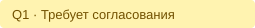
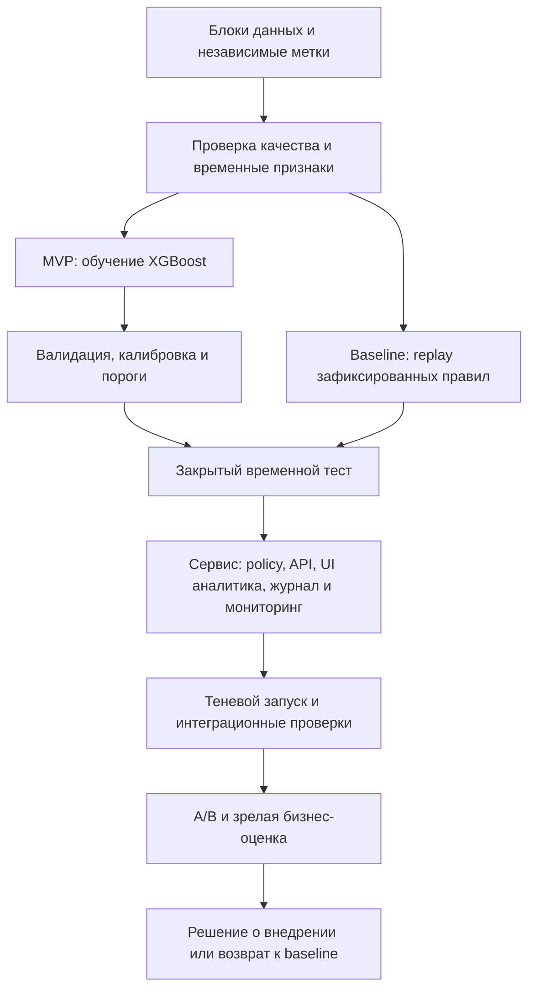
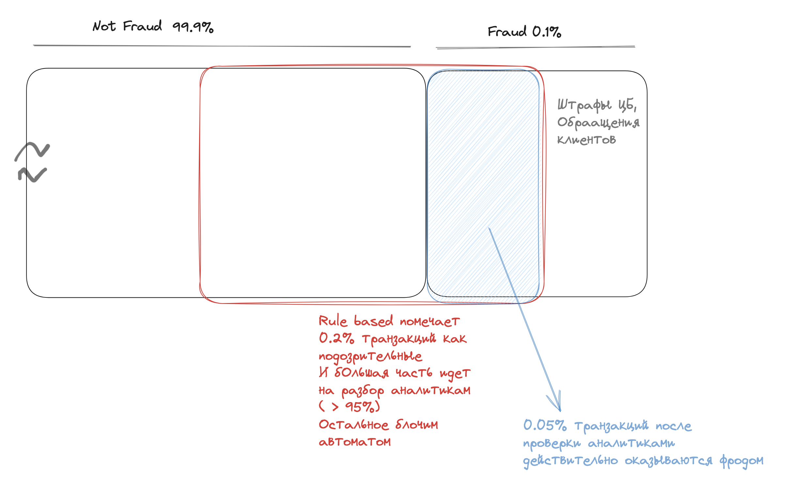
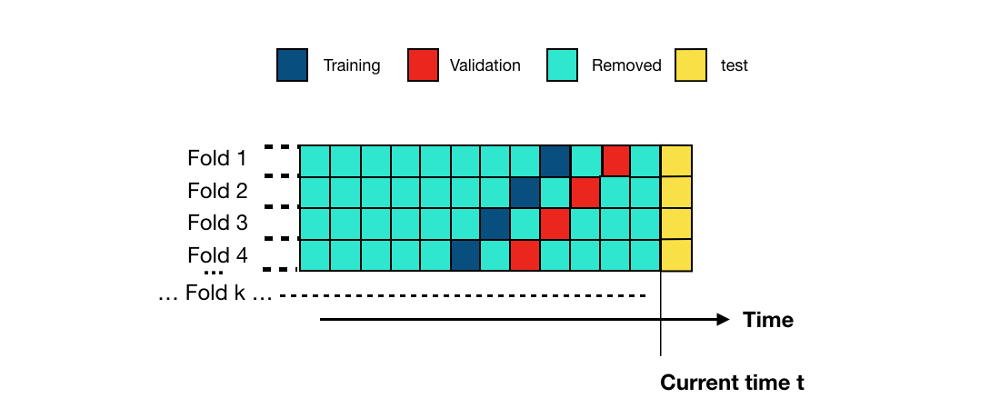
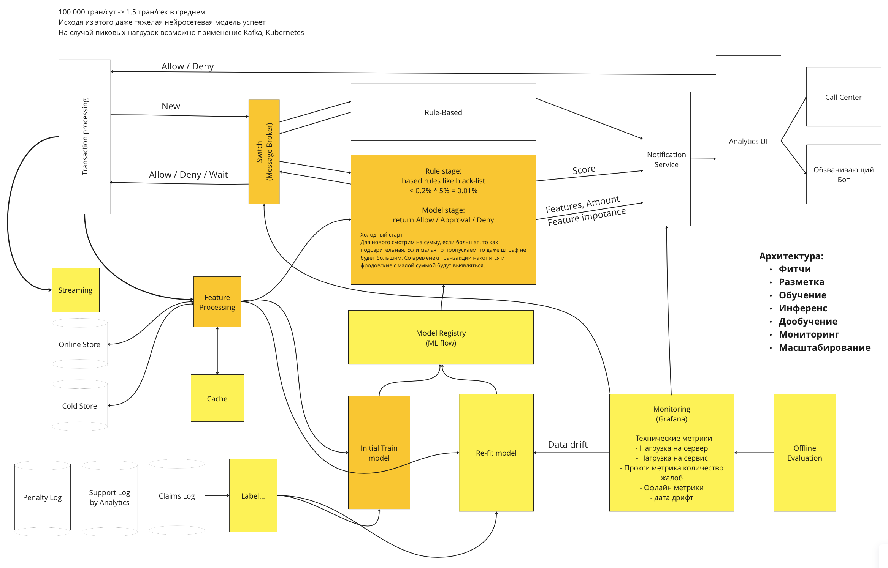
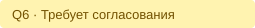

# ML System Design Doc Challenge

Design Doc был разработан в рамках секции [Reliable ML](https://ods.ai/tracks/df23-reliable-ml) на Data Fest Online 2023, контест [ML System Design Doc Challenge](https://youtu.be/fX7PhT6iY8M)

[Шаблон](https://github.com/IrinaGoloshchapova/ml_system_design_doc_ru/blob/main/ML_System_Design_Doc_Template.md) документа для дизайна ML-систем от телеграм-канала [Reliable ML](https://t.me/reliable_ml)

## Дизайн ML системы - Anti-Fraud

> Исправленная версия исходного документа. Сохранены его разделы, порядок изложения и изображения; исправлены ошибки и добавлены недостающие пояснения по критериям и предоставленному ревью. [Оригинал без изменений](ORIGINAL.md).
>
> Это учебный проект: данных банка, результатов обучения, пилота и проведённых согласований нет. **УД** означает учебное допущение. Неизвестные вопросы отмечены жёлтым и связаны с Issues; их плановые сроки и роли не являются реальными договорённостями.

Навигация: [1. Цели и предпосылки](#1-цели-и-предпосылки) · [2. Методология](#2-методология) · [3. Подготовка пилота](#3-подготовка-пилота) · [4. Внедрение](#4-внедрение).

## 1. Цели и предпосылки

### 1.1. Зачем идем в разработку продукта?

- Бизнес-цель
    - Целью внедрения данного проекта является увеличение эффективности банковской системы [антифрода](https://ru.wikipedia.org/wiki/Антифрод) для снижения финансовых и репутационных рисков связанных с мошенническими действиями. Ключевые задачи включают уменьшение количества пропущенных мошеннических (фродовых) операций, оптимизацию работы аналитиков за счет автоматизации процесса выявления подозрительных транзакций и улучшение клиентского опыта за счет сокращения неоправданных блокировок транзакций.
- Почему станет лучше, чем сейчас, от использования ML
    - Дополнительное использование машинного обучения может улучшить качество детекции мошеннических операций; это гипотеза, которую нужно проверить на временном тесте и в пилоте. Основной проблемой `rule-based моделей` обычно является их **негибкость** и **зависимость от предустановленных правил**, что ограничивает их способность адаптироваться к меняющимся стратегиям мошенников. `ML-модель`, наоборот, способна обучаться на исторических данных и **адаптироваться** к новым видам мошенничества. Также когда `rule-based модель` имеет большое количество правил, то становится сложно их контролировать. Модель может выявлять сочетания признаков, недоступные отдельному простому правилу; обнаружение новых схем без соответствующих признаков и обратной связи не гарантируется.
    - `Rule-based модель` планируется оставить для обработки хорошо детектируемых транзакций и черных списков
    - Что будем считать успехом с точки зрения бизнеса
        
        Для измерения критерия успеха используем изменение операционного вклада на клиента и окупаемость системы. Выгода — фактически полученные комиссии и снижение подтверждённых невозмещённых потерь; затраты — проверки, поддержка, разработка и эксплуатация. Формулы приведены в §1.5, пороги — в §1.2. Предполагаемые штрафы и репутационный эффект не выдаются за измеренный доход.
        
        Для оценки будем использовать следующие ключевые показатели:
        
        1. Снижение количества пропущенных фродовых операций и подтверждённых денежных потерь банка; штрафы учитываются отдельно при наличии связи с конкретным случаем.
        2. Уменьшение количества неоправданно заблокированных транзакций для улучшения клиентского опыта.
        3. Увеличение эффективности работы аналитиков за счёт автоматизации отбора подозрительных операций при ограничении объёма ручной проверки и затрат.
        4. Улучшение клиентского опыта: в пилоте контролируем частоту обращений по антифроду. Долгосрочное влияние на клиентскую базу остаётся направлением развития, а не обещанным результатом короткого пилота.

Алгоритмы бизнес-метрик (пороговые требования вынесены в §1.2):

| Метрика | Как рассчитывается и на каких данных |
| --- | --- |
| Q — операционный вклад на клиента | `profit / N_users`; формула profit и источники в §1.5. Клиенты и период наблюдения фиксируются до воздействия. |
| L — потери на клиента | Подтверждённые потери за вычетом возвратов / N_users; ledger и реестр расследований. |
| F — ложные окончательные отказы | Число законных попыток, окончательно отклонённых/истёкших либо отменённых после проверки, / все законные попытки. Независимый аудит с весами вероятностей отбора; промежуточный REVIEW не считается отказом. |
| R — доля ручных проверок | Число уникальных кейсов проверки / число уникальных попыток; case management и журнал решений. Расходы на исследовательский аудит учитываются отдельно. |
| C — обращения | `1000 × число обращений по антифроду / N_users`; повторные сообщения в одной цепочке объединяются по case_id, источник — поддержка. |

- Стоимость
    - Затраты на работу датасаентистов: Включает зарплаты и прочие расходы, связанные с наймом и содержанием команды датасаентистов, занимающихся разработкой и обслуживанием ML-моделей для антифрод системы.
    - Затраты на инфраструктуру ML-моделей: Это включает расходы, связанные с необходимой инфраструктурой для развертывания и работы ML-моделей . Это может включать в себя затраты на вычислительные ресурсы (например, серверы или облачные вычисления), хранение данных, сетевую инфраструктуру, обеспечение безопасности и т.д. Инфраструктура ML-моделей может быть дорогостоящей и требовать постоянной поддержки и обновлений, особенно при обработке больших объемов данных или в условиях высоких требований к производительности и доступности системы.
    
    Если стоимость создания и пилота не окупается дополнительным вкладом всей системы за согласованный срок, исследовательскую работу пересматриваем. Сравнение только с суммой всего фрода недостаточно: модель не предотвращает все потери. Расчёт издержек — §4.7.
    

### 1.2. Бизнес-требования и ограничения

- Краткое описание бизнес-требований. Проект направлен на повышение эффективности обнаружения и предотвращения фродовых операций путем внедрения ML-решения. Бизнес-требования включают создание и интеграцию модели, которая может обрабатывать входные данные транзакций (время, сумма, id отправителя и получателя, канал перевода, id банка отправителя и получателя, назначение платежа, данные клиента и устройства), чтобы выявлять потенциальные мошеннические действия.
- Интерпретируемость модели. Требуется для понимания мошеннических операций и адекватности модели, также для поиска путей улучшения системы.
- Бизнес-ограничения. Включают ограниченное количество аналитиков для проверки транзакций и тайминг, в рамках которого следует обнаруживать и блокировать подозрительные операции, чтобы избежать штрафов и убытков. Кроме того, система должна минимизировать ложные положительные срабатывания, чтобы не ухудшать клиентский опыт и не приводить к потере клиентов, минимизация фродовых транзакций, чтобы не получать штрафы от регулятора.
- Описание бизнес-процесса пилота, как именно мы будем использовать модель в существующем бизнес-процессе
    - **AS-IS:** платёжный сервис перед исполнением применяет правила; обязательный запрет отклоняет перевод, подозрительные случаи проверяет аналитик, остальные исполняются. Фактическая версия правил и доступность ручной проверки должны быть подтверждены владельцем антифрода.
    - **TO-BE:** правила сохраняются, к ним добавляются score и версионированная политика решений. Участники процесса: платёжная команда, аналитик антифрода, поддержка, DS и руководитель антифрода как Product Owner.
    - После разработки и тестирования ML-модель будет интегрирована в существующую систему антифрода. Входные данные о транзакциях будут подаваться на вход модели, которая будет генерировать оценку риска мошенничества для каждой транзакции. Rule-based система работает вместе с ML, а конечное действие определяет policy-компонент по явному приоритету правил и score. Rule-based модель может включать хорошо детектируемые случаи, черные списки, а также направлять на дополнительную проверку транзакции с большими суммами.
    - Во время пилотного проекта мы будем тщательно отслеживать и сравнивать эффективность модели ML с текущей системой на основе правил.
    - Однако, стоит отметить, что точную эффективность и преимущества использования ML-модели мы сможем определить только после проведения `А/B тестирования` и `экономической целесообразности`. А/B тестирование позволит нам получить надежные данные о работе модели в реальных условиях и сравнить ее эффективность с существующей системой, а оценка экономической целесообразности даст нам понять стоит ли внедрять наше ML-решение.
    - Так как антифрод — критичная система, запуск должен быть под контролем, например запись результатов в отдельную базу, которая не принимает участия в принятии решений. Такой подход обоснован, как минимум на начальных этапах запуска.
- Что считаем успешным пилотом. Требования ниже относятся ко всей системе. Текущие уровни и пороги — **УД**, а не измерения банка; перед реальным запуском их нужно подтвердить в [Issue #1](https://github.com/balamozhnovma/antifraud-ml-system-design/issues/1).

| Метрика | Текущий уровень, УД | Требование пилота |
| --- | --- | --- |
| Q | 25 руб./клиент за 28 суток | Эффект тест−контроль ≥2,5 руб./клиент; нижняя граница двустороннего 95% ДИ эффекта >0. |
| L | 10 руб./клиент | Верхняя односторонняя граница разницы тест−контроль ≤0: денежные потери не увеличиваются. |
| F | 0,15% | Верхняя граница разницы ≤+0,02 п.п.; оценка в тесте ≤0,17%. |
| R | 0,50% | Верхняя граница разницы ≤+0,10 п.п.; оценка в тесте ≤0,60%, при этом поток всех проверок и аудита не превышает ёмкость смены (§4.4). |
| C | 2/1000 клиентов | Верхняя граница разницы ≤+0,2/1000; оценка в тесте ≤2,2/1000. |

Для L/F/R/C применяются одновременные односторонние границы с Bonferroni, α=0,05/4. Для Q — одна основная гипотеза; способы оценки и кластеризация описаны в §3.1. Недостаточная мощность означает «неопределённо», а не доказательство отсутствия вреда. Дополнительно обязательны DoD (§1.3), технические ограничения (§4.4), безопасность и окупаемость не более 12 месяцев (**УД**, §4.7).

 Бизнес-пороги и фактическая база требуют согласования: [Issue #1](https://github.com/balamozhnovma/antifraud-ml-system-design/issues/1).

- Возможные пути развития проекта:
    - расширение обучающего набора данных
    - адаптация модели (дообучение) для обработки новых типов транзакций
    - расширение функциональности модели для более тонкой настройки
    - оптимизации работы с мошенническими действиями
    - добавление новых моделей (см. Интерпретируемость модели Product Owner)

### 1.3. Что входит в скоуп проекта/итерации, что не входит

- Что входит в MVP
    - Рублёвые переводы физических лиц Card2Card и Account2Account, правила baseline, ML-score до исполнения, policy, интерфейс аналитика, сбор исходов, мониторинг и откат. Обязательные запреты ML не отменяет.
    - **Definition of Done:** воспроизводимы baseline и временная оценка модели; E2E проверены обычный платёж, REVIEW и окончательное решение аналитика, конфликт правил/ML, повтор запроса, timeout и переполнение очереди; версии решений и исходы сохранены; проходят требования §1.2 и §4.4; есть runbook и протокол приёмки. MVP — весь сервис, не только модель.
    - Backend и QA проверяют сценарии, DE — данные, DS — модель, SRE — отказоустойчивость; принимают платёжная команда и руководитель антифрода. Эти проверки запланированы, но в учебном проекте ещё не выполнены.

- Что не будет закрыто
    - Проект не решит проблемы, связанные с `социально-инженерными атаками` на клиентов. Например, когда модель выявила фрод активность, с клиентом связался аналитик, которому `подтвердили`, что все хорошо, но на самом деле злоумышленнику удалось убедить клиента в необходимости сделать перевод используя `социальную-инженерию`.
    - Мы будем решать задачу классификации. В этом контексте задача детекции аномалий - это вспомогательный инструмент для поиска нового вида фрода, ручной обработки аномалий, Active Learning для разметки. Детекция такого рода не входит в скоуп проекта и является улучшением. Вариант реализации - Isolation Forest
- Описание результата с точки зрения качества кода и воспроизводимости решения
    - Результат проекта будет включать в себя четко описанный и документированный код, который можно легко внедрить в существующую систему. Модель должна быть обучена и протестирована, а ее производительность должна быть оценена с использованием отдельного тестового набора данных. Код будет структурирован таким образом, чтобы обеспечить воспроизводимость (фиксация: `random seed`, `гипер-параметры модели`, `метрик`, `train/test/valid датасет`, `артефакты`, `модель`). Также фиксируются snapshot данных, cutoff, доступность меток, версия признаков, окружение, калибровка и пороги. Изменения проходят code review, проверки временных join и интеграций.
- Описание планируемого технического долга
    - Возможные аспекты технического долга могут включать оптимизацию алгоритмов для улучшения производительности, интерпретируемости и интеграции решения.

### 1.4. Предпосылки решения

- **Данные.** Наше решение будет базироваться на данных, предоставляемых финтех компанией, включающих данные о переводах, данные о клиентах и  сторонние данные, полученные законным путем. Полноту, права и качество требуется проверить; наличие и пригодность источников в учебном проекте не подтверждены.
- **Горизонт прогноза или режим работы:** онлайн
- **Гранулярность модели.** Мы предполагаем, что наша модель будет работать на уровне отдельных транзакций, анализируя каждую транзакцию по отдельности. Это обусловлено потребностью бизнеса в реальном времени обнаруживать и блокировать подозрительные транзакции.
- **Процесс.** Мы предполагаем, что модель будет интегрирована в существующую систему обработки транзакций и будет работать совместно с rule-based антифрод системой. Правила покрывают известные обязательные сценарии, ML дополняет их оценкой сочетаний признаков. Порядок совместного решения зафиксирован в §4.1.
- **Типы фрода:** Проверяем качество отдельно по подтверждённым типам фрода, которые встречаются в данных; обнаружение всех схем не гарантируется. Примеры для анализа: схемы [обналичивания](https://ru.wikipedia.org/wiki/Обналичка), использование [дропов](https://xn--e1afpuhk.com/kartochnye-moshennichestva-s-uchastiem-dropov/), [фишинга](https://ru.wikipedia.org/wiki/Фишинг) и так далее.
- **Работа с ошибками:** Анализ ошибок и интерпретация работы модели в этих случаях необходимы для понимания краевых условий и поиска улучшения модели. В анализ входит поиск кластеров, на которых система дает ошибки, а также ручной анализ транзакций.
    
    
### 1.5. **Бизнес-метрики**

Определяем ключевые показатели, которые далее агрегируем в единую формулу в деньгах, понятную бизнесу. Показателями являются:

- Фактически полученные комиссии за исполненные транзакции.
- Подтверждённые невозмещённые потери банка после возвратов; фактические штрафы учитываются только при проверенной связи с операцией и без двойного включения в потери.
- Расходы на ручную проверку, поддержку и эксплуатацию.

Определим profit в деньгах как основную бизнес-метрику на основе этих показателей:

$$
profit = \sum_{t\in E} commission_t - \sum_t loss_t - \mu n - c_s m - C_{run}
$$

Где:

- `E` — множество фактически исполненных переводов включённых клиентов за фиксированный период наблюдения.
- `commission_t` — фактически полученная комиссия из ledger; при постоянной ставке её можно представить как `λ × сумма перевода`.
- `loss_t` — невозмещённая потеря банка по операции из реестра расследований и ledger; она не обязательно равна сумме перевода и не равна автоматически штрафу.
- `n` — число уникальных дел ручной проверки, `μ` — стоимость одного дела; источник — case management и согласованная ставка затрат.
- `m` — число обращений по антифроду после дедупликации цепочек, `c_s` — стоимость обработки обращения; источник — поддержка.
- `C_run` — эксплуатационные расходы за тот же период. Единовременная разработка включается в окупаемость (§4.7).

У ложно заблокированного платежа комиссия не получена и уже отсутствует в первом слагаемом. Второй раз вычитать её нельзя. Предотвращённая сумма перевода не записывается доходом. Предполагаемый уход клиента после жалобы без измеренной связи не монетизируется; клиентский опыт контролируется отдельно метрикой C.

Для сравнения A/B используем `Q = profit / N_users`: всех включённых клиентов наблюдаем одинаковые 28 суток (**УД**), включая их повторные попытки после отказа. Источники связываются по transaction_id, клиенту и группе, расходы распределяются по единому зафиксированному правилу. Метрики считаются после созревания исходов, а не только по доступным сегодня подтверждениям. Крупные потери не удаляются из расчёта.

Определим Normalized Profit как дополнительную описательную метрику на одном фиксированном наборе операций:

$$
M = \sum_{t:y_t=0} commission^{potential}_t, \qquad nProfit = \frac{profit}{M}, \quad M>0.
$$

`M` — потенциальная комиссия при исполнении всех законных попыток по одному тарифу, а не доказанный максимум прибыли. Отрицательное nProfit означает убыток, но показатель не обязан лежать в [0;1] и не заменяет Q в A/B. При неизвестных метках или M=0 его не рассчитываем. Нельзя сравнивать nProfit групп как денежный эффект, игнорируя изменение состава/числа попыток.

 Подтверждение денежных определений и базы: [Issue #1](https://github.com/balamozhnovma/antifraud-ml-system-design/issues/1).

## 2. Методология

### 2.1. Постановка задачи

Задача бинарной классификации с большим дисбалансом классов: до исполнения отдельной попытки перевода оценить вероятность подтверждённого фрода по доступным на тот момент признакам. Из score политика формирует разрешение, проверку или отказ; это не трёхклассовая разметка. 

### 2.2. Блок-схема решения

Решение по платежу — синхронное online до исполнения, обновление короткой истории — потоковое, обучение и дозревшие отчёты — batch. Блочная архитектура исходника сохранена в §4.1.

### 2.3. Этапы решения задачи

Ниже описан план: формулировки «Результат» обозначают ожидаемый выход этапа. EDA, обучение и испытания в этом учебном проекте ещё не выполнены.

### 2.3.1 Выбор метрик

**Оффлайн-метрики** - это метрики, оценивающие производительность системы  на основе исторических данных и фактических результатов. 

Распределение транзакций в исходной системе

В соответствии с бизнес-метрикой наша основная цель — уменьшить потери от пропущенного фрода, не создавая лишних окончательных отказов и проверок. Recall отражает долю найденного фрода, Specificity — долю законных операций ниже порога score. Денежный эффект зависит также от сумм, исходов проверки и затрат, поэтому рост Recall сам по себе не доказывает рост profit.

В исходнике приведён ориентир `Recall=50% при Specificity=99,85%`; независимого подтверждения этих значений нет. Учебная цель — `Recall≥60% при Specificity≥99,85%` (**УД**), то есть `FPR≤0,15%`, на отдельном временном test с независимыми зрелыми метками. Порог выбирается на validation и затем фиксируется. Эмпирические метрики по порогу ступенчатые: нельзя считать Recall@Specificity гладкой функцией.

Считаем `Recall=TP/(TP+FN)`, `Specificity=TN/(TN+FP)`, `Precision=TP/(TP+FP)`, PR-AUC на естественной доле классов и amount-weighted Recall по сумме фродовых переводов. ML-положительный исход здесь — `score≥t_review`, то есть направление на проверку/отказ. F из §1.1 считается по окончательному статусу всей системы; это другой показатель. Нужны доверительные интервалы, знаменатели и срезы по каналу/сумме. Калибровка проверяется Brier score и reliability diagram на отдельном зрелом периоде. Все метрики — план расчётов, не полученные результаты.

**Онлайн метрики** -  это метрики, которые мы можем получить во время работы системы. 

Сразу доступны задержка, ошибки, доля проверок и обращения. Они используются для контроля пилота. Основные денежные и fraud-метрики поступают с задержкой подтверждения; A/B можно оценить после дозревания. Уменьшение жалоб не заменяет доказательство снижения фрода.

**Технические метрики** - это метрики, связанные с производительностью и скоростью работы системы антифрод. Некоторые примеры таких метрик включают:

- Скорость обработки транзакций антифрод системой: эта метрика измеряет время, затраченное системой антифрод на обработку каждой транзакции. Ожидается, что время обработки будет ≤ *1c*, чтобы не ухудшать пользовательский опыт и обеспечивать быструю реакцию на мошеннические операции.

Выбор этих метрик позволяет нам оценить эффективность системы  с различных сторон, включая бизнес-показатели, точность обнаружения мошеннической активности и производительность системы. Это позволит нам принять более информированные решения и улучшить антифрод систему  в соответствии с требованиями проекта и бизнес-целями.

### 2.3.2 Определение объекта и таргета

- Объект — уникальная попытка перевода с transaction_id, получателем, отправителем, временем и другими полями. Retry API с тем же ID не создаёт новый объект.
- Целевая переменная: подтверждённый фрод — `1`, подтверждённая законная либо созревшая исполненная операция без спора — `0`; непроверенная отклонённая операция — `unknown`. Решение правил не является целевой переменной.

### 2.3.3 Сбор данных

Целевую переменную получаем из подтверждённых результатов расследований аналитиков и подтверждённых претензий, связанных с transaction_id. Black list, решение rule-based и сам факт штрафа не считаются независимым ground truth. Противоречия передаются старшему аналитику и до разрешения имеют статус unknown.

Для метки сохраняем источник, версию и `label_available_at`. Законность исполненной операции без претензии допускается после окна созревания 60 суток (**УД**, проверить хвост поздних подтверждений и полноту канала жалоб). Отсутствие жалобы сразу после платежа не означает y=0.

Для оценки false blocks и полного Recall нужен независимый аудит разрешённых, проверяемых и отклонённых попыток с известными вероятностями отбора. Используем веса `1 / probability`, отдельно показываем coverage и unknown. Аудит не означает разрешение опасного платежа. Если отклонённые операции нельзя независимо разметить, полные F/Recall недостоверны: это блокер пилота, не повод подменить метки правилами.

 Регламент разметки, аудит и источники: [Issue #2](https://github.com/balamozhnovma/antifraud-ml-system-design/issues/2).

Информация о получении данных:

До EDA согласуются смысловые блоки: операции и ledger (платёжная команда/DE), профиль и история клиента (владелец CRM), устройство (команда приложения/ИБ), правила и кейсы (антифрод), расследования и претензии (старший аналитик), расходы и обращения (финконтролёр/поддержка). Точные таблицы, права, покрытие периода и online-доступность пока неизвестны. Следующая таблица уточняет предполагаемые поля внутри этих блоков, а не утверждает, что доступ уже получен. Согласование с заказчиком/научным руководителем требуется в Issues #2–3.

| Название данных | Есть ли данные в компании (если да, название источника/витрины) | Требуемый ресурс для получения данных (какие роли нужны) | Проверено ли качество данных (да, нет) |
| --- | --- | --- | --- |
| Истории транзакций за последние N-месяцев | Предполагается журнал процессинга / профиль клиента; подтвердить источник | Product owner | Нет |
| Целевая переменная | Реестр расследований и подтверждённых претензий; связать с попытками | Product owner/ Отдел аналитиков | Нет |
| Время транзакции | Предполагается история операций; подтвердить источник | Product owner | Нет |
| Сумма транзакции | Предполагается история операций; подтвердить источник | Product owner | Нет |
| ID отправителя | Предполагается история операций; подтвердить источник | Product owner | Нет |
| ID получателя | Предполагается история операций; подтвердить источник | Product owner | Нет |
| Канал перевода | Предполагается история операций; подтвердить источник | Product owner | Нет |
| ID банка отправителя | Предполагается история операций; подтвердить источник | Product owner | Нет |
| ID банка получателя | Предполагается история операций; подтвердить источник | Product owner | Нет |
| Назначение платежа* | Вне MVP; источник и необходимость — для следующей итерации | Роль с доступом к базе данных | Нет |
| Данные клиента (соц демо, последние операции) | История клиента — предполагаемый источник; соцдем вне MVP | Product owner | Нет |
| Данные устройства, с которого переводят (версия ОС, имя приложения и т.п.) | Предполагается журнал процессинга / профиль клиента; подтвердить источник | Product owner | Нет |

### 2.3.4 Подготовка данных

Этап 0: анализ временного ряда на всех доступных данных; указанная в исходнике трёхлетняя история пока не подтверждена. Проверка гипотез о сезонности транзакций в рамках разных регионов. По результату: принятие решение об отрезке времени, на котором будет основано итоговое решение задачи. 

Этап 1: Проверка каждого признака

| Название данных | Требования |
| --- | --- |
| Истории транзакций за последние N-месяцев | - Убедиться, что данные охватывают выбранный период без пропусков. |
| Целевая переменная | - Определить критерии классификации мошеннических операций. |
| Время транзакции | - Убедиться в правильном формате данных времени. |
| Сумма транзакции | - Проверить отсутствие пропусков в колонке с суммой транзакции. |
| ID отправителя | - Проверить отсутствие пропусков в колонке с ID отправителя. |
| ID получателя | - Проверить отсутствие пропусков в колонке с ID получателя. |
| Канал перевода | - Проверить наличие корректных значений каналов перевода. |
| ID банка отправителя | - Проверить наличие корректных значений ID банка отправителя. |
| ID банка получателя | - Проверить наличие корректных значений ID банка получателя. |
| Назначение платежа* | - Проверять только при отдельном включении поля в следующую итерацию. |
| Данные клиента (соц демо, последние операции) | - Определить необходимые атрибуты клиента и проверить их наличие и корректность. |
| Данные устройства, с которого переводят | - Определить необходимые атрибуты устройства и проверить их наличие и корректность. |

Этап 2: оценка естественного дисбаланса классов и его изменения во времени/по каналам. Выравнивать validation/test по таргету не следует.

**Результат:** Чистый и корректный набор данных для задачи

### 2.3.5 Работа с признаками

- Проверка распределения транзакций во временном ряду в рамках выбранного отрезка времени, проверка отсутствия значительных пропусков.
- Оценка распределений целевого признака для типа перевода Card2Card/Account2Account. Проверка гипотез о специфичностях категорий (разные по сумме типичные транзакции, разная частота транзакций, разное соотношение мошеннических транзакций);
- Проверка гипотез о сезонности. Уточнение отрезка времени, необходимого для пересчета модели;
- Оценка корректности разметки данных. Часть данных должна быть передана на повторную проверочную разметку для подтверждения уверенности в разметке;
- Оценка важности признаков для baseline и MVP, формулирование гипотез для новых признаков с целью улучшения качества системы (возможные варианты признаков — время между транзакциями одного пользователя, обыкновенная частота транзакций для времени/дня недели, неизвестный (новый) девайс пользователя);
- Признак времени с последней транзакции, количества транзакций за последние N минут;
- Признак нового устройства; локацию, свободный текст назначения и социально-демографические поля не включаем в MVP без подтверждённой необходимости и допуска ИБ.

**Результат:** 
1. Включение или исключение фактора полной даты транзакции в датасет;
2. Проверено влияние фактора ошибки разметчиков в наборе данных;
3. Сформулированы гипотезы о возможных новых признаках для обогащения набора данных;
4. Сделана оценка оптимального периода перетренировки модели, в том числе с учетом задержки в получении разметки новых данных.

**Необходимая проверка бизнеса:** оценка согласованности гипотез о новых признаках с предметной областью. Все признаки доступны до решения: историческое событие должно предшествовать попытке, а `available_at` — быть не позже cutoff. Текущая попытка в свои агрегаты не входит; поздно доставленную историю нельзя задним числом использовать как будто она была доступна online.

### 2.3.6 Оценка поведения baseline

Baseline — существующая rule-based политика. Для воспроизводимости фиксируем rules_v0: порядок правил, пороги, входные поля, даты действия, исторические списки ограничений, направления на проверку и окончательные исходы. Replay проводится на тех же доступных в момент решения данных и зрелых метках, что оценка ML. Фактические правила ещё не получены.

Для учебного прототипа определён формальный baseline (**УД**): обязательный запрет → BLOCK; иначе сумма≥100 000 руб. либо (новое устройство и ≥3 предшествующих попытки за 10 минут) → REVIEW; иначе ALLOW. Поля: сумма, статус обязательного запрета, устройство и история попыток. Это не утверждение о правилах банка. Правила и признаки согласует руководитель антифрода / научный руководитель: [Issue #3](https://github.com/balamozhnovma/antifraud-ml-system-design/issues/3).

Вход этапа — rules_v0 и подготовленный snapshot; выход — replay-отчёт с покрытием, F/R и затратами. Для перехода к сравнению моделей нужно подтвердить совпадение replay с исходной политикой либо объяснить расхождения.

### 2.3.6.1 Применение методов интерпретации к признакам для baseline

**Возможные методы:** для правил — анализ вклада и абляция отдельных правил, доля срабатываний и проверка порогов. Permutation importance, ICE и PDP применимы к обученной численной модели с оговорками о зависимых признаках; для формальных правил основной метод — разбор самих условий.

**Результат:** При необходимости коррекция признаков на основе выводов, извлекаемых с интерпретацией

**Необходимая проверка бизнеса:** оценка согласованности интерпретаций с предметной областью во избежание искажений 

### 2.3.7 Подготовка тренировочного и тестового наборов данных

На основе EDA для формирования train, valid и test set планируется учесть следующие составляющие:

1. Нюансы временного ряда — разбиение датасета без внесения информации о потенциальном будущем в модель;
2. Сохранение естественного распределения классов и хронологии в validation/test. Class weights или undersampling допустимы только в train; вероятности отбора сохраняются, калибровка проверяется на естественной частоте. SMOTE/ADASYN через границы временных выборок не применяются.

**Результат:** сформированы воспроизводимые train/validation/test и manifest с cutoff, временем доступности меток, схемой признаков и их преобразований; это ожидаемый выход этапа, а не выполненный расчёт.

### 2.3.8 Валидация

- В качестве валидационной стратегии будет использоваться Time-Series Validation, которая учитывает временные аспекты данных и обеспечивает более реалистичную оценку ее производительности.

- При использовании Time-Series Validation датасет делится на K фолдов, где каждый фолд содержит train до cutoff и следующий временной validation. Отдельный будущий test используется однократно после выбора модели/порогов; результаты test не участвуют в выборе конфигурации.
- На историческую дату обучения c используются только метки с `label_available_at≤c` и признаки, доступные в момент платежа. Одного gap 1–2 недели недостаточно при задержке меток до 60 суток. После validation длительностью 28 суток ждём её дозревания (УД: 60 суток), затем замораживаем bundle; только следующий период идёт в test. Его отчёт также ждёт созревания. Калибратор не обучается на train модели; при переобучении перед test для него выделяется отдельный зрелый период, а score и пороги заново фиксируются до test.
- Использование Time-Series Validation позволяет учесть хронологический порядок данных и оценить производительность модели в реалистичных условиях.

### 2.3.9 Выбор архитектуры модели для решения задачи

### От baseline к полноценной модели

В качестве отправного качества планируется взять качество нынешней rule-based системы.

**Особенности работы**

Учитывая особенности исторической системы, сохраняем три действия системы: Разрешить / Проверить / Запретить. Модель выдаёт score, а policy переводит его в действие с учётом правил и ёмкости. Проверка — промежуточный статус; аналитик отдельно разрешает или отклоняет платёж.

Система, как было указано выше, будет работать параллельно с rule-based моделью. Rule-based модель остается работать параллельно, а конечный вердикт выносится на основе предикта от обеих систем. Rule-based модель может включать хорошо детектируемые случаи, черные списки, а также направлять на дополнительную проверку транзакции с большими суммами.

Заявки для аналитиков обрабатываются очередью с учетом приоритета, который определяется на основе score и суммы транзакции.

Для независимой оценки и будущего переобучения заранее резервируется ресурс на случайный стратифицированный аудит, включая низкий риск и отклонённые попытки; вероятности отбора логируются. Его нельзя ограничивать только случайными периодами свободной очереди без учёта selection bias.

**Этап 1 (MVP)**. Стартовая модель — `XGBoost` для бинарной классификации табличных признаков. Выбор обусловлен нелинейными сочетаниями суммы, частоты и новизны устройства, CPU-инференсом и возможностью ограничить сложность; это инженерная гипотеза, не обещание превосходства. Основание: [Chen, Guestrin, XGBoost](https://arxiv.org/abs/1603.02754). `Logistic Regression` на том же наборе служит простым ML-сравнением. One-Class SVM и поиск аномалий не смешиваются с supervised-постановкой MVP.

Стартовые признаки: log(1+сумма), канал, банки, час/день недели, число/сумма предшествующих попыток за 10 минут/час/сутки, время с прошлой попытки, давность клиента, новый получатель и устройство. ID служат для join, не самостоятельными признаками. Преобразования обучаются только на train; неизвестные категории и пропуски обрабатываются явно. Согласование этого списка ещё предстоит (Issue #3).

Вход — подготовленные временные выборки и baseline-отчёт; выход — bundle, validation-метрики, калибратор и два порога `t_review≤t_block`. Пороги выбираются по затратам и ограничениям FPR/очереди на validation, численно фиксируются после обучения до test. Без отдельного допуска автоматические ML-блокировки работают как REVIEW. MVP включает также сервис, интерфейс и проверки из §1.3.

**Этап 2**. Тестирование оптимизаций для алгоритмов, бьющих baseline.

Данный этап включает в себя варьирование гиперпараметров — математических и эвристических показателей модели, для её улучшения, а также подбор подходящих признаков

**Этап 3**. Исследование нейросетей — `Autoencoder`, возможных GAN-подходов — отложено за пределы MVP. Их превосходство и более высокая точность не предполагаются заранее. Autoencoder может дать anomaly score по ошибке восстановления на нормальных операциях, но высокий score не доказывает фрод.

Ссылка исходника [Zou et al., 1908.11553](https://arxiv.org/abs/1908.11553) описывает denoising autoencoder и работу с дисбалансом, а не служит обоснованием приведённого в исходнике алгоритма Autoencoder+GAN. Дискриминатор «реальные нормальные репрезентации против сгенерированных» не становится автоматически классификатором fraud/normal; такая гипотеза требует самостоятельной постановки и независимой оценки. Поэтому неподтверждённые и повторяющиеся шаги GAN удалены из плана реализации.

**Этап 4**. Сопоставление baseline, Logistic Regression и XGBoost на одном закрытом временном test по ML-метрикам, затратам и ограничениям системы. Неудача на test требует новой итерации и нового holdout, а не подбора по этому же test.

**Результат:** выбрана одна обоснованная модель для MVP либо сохранён baseline, если улучшение не подтверждено. Набор кандидатов не является готовой системой.

### 2.3.10 Методы интерпретации

- Используем анализ интерпретируемости по всей модели для выявления паттернов и значимых признаков
- Используем анализ интерпретируемости отдельного предикта для обработки ошибок и анализа конкретных видов фрода
- Способы интерпретации моделей**:**
    - Для модели MVP XGBoost используем SHAP и разбор конкретных ошибок; для baseline — условия правил. SHAP описывает вклад признаков в score и не доказывает причинность.
    - Для отложенных нейросетевых исследований возможны model-agnostic методы, но их корректность и стоимость нужно проверять отдельно. Например [тут](https://heka-ai.medium.com/detection-and-interpretation-of-outliers-thanks-to-autoencoder-and-shap-values-c8bcdc5ebc1e) есть применение SHAP для интерпретации Autoencoder. Это не делает экспериментальную связку Autoencoder+GAN подтверждённым решением задачи.
    - Также в качестве возможных методов интерпретации, которые можно подсчитать почти для любого типа моделей — Permutation importance, Individual Conditional Expectation, Counterfactual Explanations and Partial dependence plots.

### 2.3.11 Анализ ошибок

Анализ наличия и природы ошибок в MVP. Проверка модели при помощи методов интерпретации, оценка корректности гиперпараметров. При необходимости возвращение к пунктам 2.3.4—2.3.10.

**Результат:** отчёт об ошибках и решение о пригодности модели. Если требования на test не достигнуты, модель не считается готовой; итерация использует новый holdout, а не подгонку под прежний test. 

**Необходимая проверка бизнеса:** Согласованность качества модели с требованиями бизнеса;

## 3. Подготовка пилота

### 3.1. Способ оценки пилота

В исторической системе транзакции поступали на RuleBased блок. Добавляем  Switch, который будет разделять и/или перенаправлять транзакции на новую или историческую системы. Разделение транзакций позволит сделать AB-тест, посчитать офлайн метрики и оценить эффективность решения.

Для A/B используем Q и ограничения L/F/R/C из §1.1–1.2. Жалобы и технические метрики доступны раньше и служат контролю, но финальная оценка ждёт зрелой разметки. Группы назначаются клиентам-отправителям, не отдельным транзакциям; назначение сохраняется. Все исходы уже включённого клиента, включая fallback и последующие обязательные запреты, остаются в intention-to-treat учёте.

Последовательность подготовки AB-теста:

- Определить метрики:
    - В ходе A/B контролируем обращения, очередь, задержку и ошибки; после завершения одинакового окна клиентов и созревания меток рассчитываем Q/L/F и остальные критерии. Срок созревания 60 суток — УД, проверяемое по данным. 
    - Вспомогательные метрики, которые должны показать, что тест идет так как предполагалось и не затронул другие области, например это количество транзакций, сумма транзакций и т.д.
    - Контрольные метрики, которые будут позволять отлавливать проблемы, такие как время проведения транзакции, обращения в поддержку и другие
- Определить с бизнесом, какой эффект мы собираемся детектировать. Определить уровень значимости и допустимый уровень ошибок второго рода
- Отбор групп должен производиться по пользователям, а не по транзакциям, чтобы избежать зависимости данных. Обычно, в организации проводятся несколько AB-тестов и существует система разбиения с одинарным или двойным хешированием
- Оценить возможности увеличения мощности теста, такие как уменьшение дисперсии, стратификация, CUPED и другие
- По минимально полезному эффекту, дисперсии и сезонности определить долю клиентов и длительность. Доверительные интервалы строятся с кластеризацией по отправителю; тяжёлые потери не отбрасываются ради значимости. Метод фиксируется до старта; календарные блоки и фродовые инциденты проверяются в анализе чувствительности.
- Подготовить техническую основу теста
- Проверить тест на исторических данных и оценить ошибку первого рода и мощность для Q и каждого защитного ограничения, включая весовой аудит F. Возможная интерференция через получателей/фродовые сети и общую очередь требует проверки; при существенном влиянии до старта выбирается кластерная рандомизация и пересчитывается мощность.

**Предлагаемые параметры пилота (УД):** shadow 14 суток, A/A маршрутизации 7 суток, отдельный технический canary 1%/5% клиентов, затем подтверждающий A/B 50/50. Canary-клиенты в подтверждающую выборку не включаются. Набор в A/B — 28 суток, наблюдение каждого клиента — 28 суток, созревание последнего исхода — ещё 60 суток: итог не ранее 116 суток от старта набора. Возможный набор 56 суток выбирается до старта по мощности, не после просмотра p-value.

Для Q: α=0,05, power=0,8, эффект 2,5 руб./клиент; при УД σ=50 руб. иллюстративно `n≈2×(1,96+0,84)²×50²/2,5²=6272 клиента/группу`. Это не достаточный объём всего пилота: для F при базе 0,15%, границе +0,02 п.п. и Bonferroni грубая независимая оценка — около 712 тыс. зрелых законных попыток/группу до кластеризации и потерь аудита. Реальный n — максимум требований всех метрик, полученный симуляцией на доступных данных. Если трафика/аудита не хватает, подтверждающий пилот не запускается.

**Кто тестирует и принимает:** QA — E2E, DS — модель и метрики, DE — источники, SRE — нагрузка/отказы, старший аналитик — аудит, аналитик экспериментов — A/B и отчёт, финконтролёр — экономика. Решение принимает руководитель антифрода / Product Owner после заключений платёжной команды и ИБ. ФИО и согласование научного руководителя пока неизвестны.

 [Issue #4 — мощность и календарь](https://github.com/balamozhnovma/antifraud-ml-system-design/issues/4).  [Issue #7 — роли и ревью](https://github.com/balamozhnovma/antifraud-ml-system-design/issues/7).

Во время проведения пилота

- При первом запуске предусмотреть “параллельный” запуск, при котором решение, принятое системой по каждой транзакции, не идет в работу, а сохраняется отдельно для анализа
- Возможно, использовать постепенное развертывание, при котором мы запускаем на новую систему не сразу на всех планируемых транзакциях
- Следить за назначением групп, SRM по клиентам, полнотой исходов и ёмкостью очередей. Критичный fraud-инцидент или техническая деградация останавливает ML-влияние по runbook; это не объявляет победу. Ежедневного выбора победителя по p-value не проводится.

### 3.2. Что считаем успешным пилотом

По завершению теста принимаем решение. 

Пилот считается успешным при одновременном выполнении требований к **каждой** метрике из §1.1 с уровнями и порогами §1.2. Формулы и численные требования здесь не дублируются. Дополнительно пройдены DoD, нагрузочные и интеграционные проверки, безопасность, независимое ревью и подтверждена окупаемость §4.7.

В случае успеха пилота переходим к внедрению по решению руководителя антифрода. При нарушении ограничений возвращаемся к baseline, определяем и исправляем ошибки или отказываемся от решения. При недостатке мощности, незрелых исходах или нарушенной рандомизации результат — **неопределённый**, расширение запрещено; проектируется новый тест.

При любом исходе пилота сохраняем отчёт, версии модели/правил/порогов и решение принимающего лица, собираем новые идеи и гипотезы. До завершения фактических испытаний этот документ не заявляет успешность пилота.

## 4. Внедрение

### 4.1. Архитектура решения

Архитектура решения. 

**Белые блоки** - историческая система

**Цветные блоки** - новая система

**Темный цвет** выделяет блоки, относящиеся к пилоту

Исходная схема сохранена. Чтобы сделать приоритеты на ней однозначными: окончательное действие выбирает policy. Обязательный запрет и исходный BLOCK сохраняются; исходный REVIEW либо score между порогами направляет на проверку; score≥t_block даёт BLOCK только после отдельного допуска; низкий score при разрешении baseline даёт ALLOW. В тестовой группе вычисляются оба результата, в контроле действует baseline. При timeout ML/признаков или перегрузке возвращаемся к исходной политике, а не к безусловному разрешению. Ранее открытые кейсы не теряются и не исполняются молча.

Клиент видит статус ожидания проверки, аналитик — причины score, сумму, версии и срок; его окончательное решение асинхронно возвращается платёжному сервису. Если у сервиса нет pending/callback-сценария, REVIEW нельзя включить до доработки.

| Связь компонентов исходной схемы | Предлагаемый контракт |
| --- | --- |
| Платёжный сервис → оркестратор | `POST /v1/decisions`: transaction_id, сумма/валюта, время, канал, токенизированные участники/устройство. Ответ: ALLOW/REVIEW/BLOCK, decision_id, причины, версии правил/модели/политики и fallback_flag. |
| Признаки → скоринг | Snapshot с cutoff, feature-schema, missing и watermark; несовместимая схема или устаревшие данные приводят к fallback. |
| Policy → очередь/интерфейс аналитика | Durable `review.created`, один case_id на попытку, at-least-once доставка и дедупликация. REVIEW подтверждается только после надёжной записи. |
| Аналитик → платёжный сервис | Авторизованный `POST /v1/review-decisions`: case_id, transaction_id, окончательный исход, версия и время; проверка допустимых переходов и запоздалых callback. |
| Платежи/аналитик → журнал, обучение и мониторинг | События статусов и versioned labels с event_time и available_at; durable outbox, replay и audit. Решение аналитика и подтверждение fraud — разные сущности. |
| Реестр моделей → скоринг | Проверенный immutable bundle: модель, калибратор, признаки, schema и policy; совместимость и атомарный откат. |

Retry с тем же transaction_id и телом возвращает сохранённое решение, изменённое тело — 409. Повторный callback не исполняет платёж дважды. Лимит pending, ёмкость и контракт аварии согласуются с платёжной командой:  [Issue #3](https://github.com/balamozhnovma/antifraud-ml-system-design/issues/3).

### 4.2. Описание инфраструктуры и масштабируемости

- Несмотря на указанную в исходнике среднюю нагрузку 1,5 транзакции в секунду (независимо не проверена), нужно предусмотреть пики, связанные с цикличностью нагрузки и фрод-атаками.
- Очередь сообщений может быть организована на брокере сообщений, например Kafka
- Инференс модели может быть организован в существующем Kubernetes-кластере с масштабированием по нагрузке и задержке; отдельный кластер ради средней нагрузки 1,5/s не требуется. Начальное УД: две CPU-реплики на разных узлах, модель в памяти; online store для агрегатов, надёжный журнал решений и существующий брокер. Ресурсы определяются профилированием.
- Узкие места: получение признаков, горячие отправители, запись outbox и очередь аналитиков. Добавление scoring-реплик не устраняет эти ограничения. Состояние признаков восстанавливается из event log; при неполном восстановлении ML отключён.

### 4.3. Мониторинг

Сервис мониторинга контролирует:

- Технические метрики
- Нагрузка на сервер
- Нагрузка на сервис
- Прокси метрика количество жалоб
- Офлайн метрики
- Дрейф данных и score; пропуски, неизвестные категории, watermark и расхождение offline/online признаков

В результате превышения порогов вызываются 

- переключение на предыдущую или историческую модель
- оповещения аналитикам и другим службам
- запуск пайплайна проверки данных и кандидата на переобучение; сам дрейф не даёт права автоматически заменить production-модель.

Предложение для MVP: ежемесячно обучать кандидата на rolling 6 месяцах с доступными зрелыми метками (УД), пройти temporal gates и анализ ошибок, shadow/canary и ручной допуск DS lead/руководителя антифрода. При провале остаётся предыдущий совместимый bundle или baseline. Технические метрики контролируются сразу, Q/L/F и ML-качество — по зрелым когортам; дата as-of и coverage видны на dashboard.

### 4.4. Требования к работе системы

- Требования проверяются нагрузочным тестом, а не считаются обеспеченными одной архитектурой. Проектные УД: p95≤300 ms, p99≤700 ms, общий timeout 1 s от получения запроса до policy-ответа, включая fallback; пик 100 req/s на 10 минут. Доступность корректного решения (включая B0 fallback) ≥99,9% за 30 суток, то есть не более 43,2 минуты недоступности; fallback измеряется отдельно.
- При 1,5 попытки/с: 129 600 попыток/сутки. При 5 KB decision/features log — около 0,65 GB/сутки и 58 GB/90 суток raw; репликация, брокер и backups дополнительно. При трёх событиях по 2 KB — около 0,78 GB/сутки raw event log.
- УД по ёмкости: 3 аналитика ×8 часов /1,6 минуты =900 кейсов/сутки, безопасный предел 80%=720 вместе с аудитом. ML-REVIEW работает в часы подтверждённого покрытия сменой; иначе B0. Даже 0,6% от среднего полного потока даёт 778 кейсов/сутки: абсолютная ёмкость и backlog строже процентного порога R. Pending и backlog ограничиваются временем работы смены, а не только суточной квотой.
- Предлагаемый feature lag: p95≤5 s, p99≤15 s; при watermark lag>30 s — fallback. Возврат к B0≤1 минуты, восстановление scoring≤30 минут; принятые решения не теряются благодаря ledger/durable outbox. Точные требования и аварийный контракт подтверждает платёжная команда.
- Нагрузочные сценарии: steady, spike, retry storm, горячий отправитель, late/out-of-order events, падение scoring/store/broker, переполнение очереди и rolling deployment. QA/SRE проверяют latency, errors, целостность журнала, отсутствие дублей и откат. Результатов ещё нет.

 Нагрузка, платформа и восстановление: [Issue #5](https://github.com/balamozhnovma/antifraud-ml-system-design/issues/5).

### 4.5. Безопасность системы

Отсутствие внешних связей само по себе не обеспечивает безопасность. Нужны service authentication/mTLS, сетевые ограничения, роли минимальных прав, управление секретами, проверка входных данных, audit изменения правил/разметки, проверенные образы и bundle. Сценарий инцидента и допуск production согласуются с ИБ.

### 4.6. Безопасность данных

Хранение на внутренних серверах не заменяет защиту данных. Нужны минимизация полей, шифрование транспорта/хранилищ, токенизация ID, раздельные роли аналитика/обучения/скоринга и журнал доступа. В публичном GitHub — только дизайн, без банковских данных и артефактов из них. Основания обработки, сроки хранения/удаления, snapshots и backups согласуются с владельцами данных/ИБ; юридическая экспертиза в учебном проекте не проводилась.

 [Issue #6 — безопасность и данные](https://github.com/balamozhnovma/antifraud-ml-system-design/issues/6).

### 4.7. Издержки

- Расчетные издержки на работу системы в месяц
- Зарплаты 3 МЛ специалистов на период от 2 - 4 месяцев для создания MVP
- Затраты на инфраструктуру

Расходы разработки `C_build = Σ(FTE × месяцы × ставка) + интеграция/QA/SRE + пилот/аудит + резерв`; эксплуатация, проверки и поддержка учитываются в profit один раз. Пример УД: C_build=3,24 млн руб., валовая дополнительная выгода=800 тыс./мес., дополнительные операционные расходы=250 тыс./мес.; чистый эффект 550 тыс./мес., окупаемость≈5,9 месяца. При половине валовой выгоды — 21,6 месяца, что не проходит предложенный лимит 12 месяцев. Это сценарий, не смета банка и не результат пилота; фактические ставки, длительный пилот и ресурс аудита требуют Issue #1/#5. Масштаб клиентов и период денежного расчёта должны совпадать с оценкой Q.

### 4.8. Риски

- Риск пропустить фродовую операцию с большой суммой — согласованные пороги/приоритеты правил и проверки с учётом ёмкости, объяснение score и контроль зрелых денежных потерь. Безусловная отправка всех крупных операций не должна переполнять очередь; решение подтверждает руководитель антифрода.
- Атака на модель или данные — изоляция затронутого bundle, расследование ИБ, временный возврат к проверенным правилам; резервные реплики сами по себе не устраняют атаку.
- Технический сбой в модели - переключаемся на предыдущую или историческую
- Сбой метрик мониторинга выше среднего порога - оповещение
- Сбой метрик мониторинга выше верхнего порога - переключаемся на предыдущую или историческую
- Риск пропуска/задержки данных — контроль полноты, available_at и watermark; при нарушении — fallback и восстановление источников силами DE/SRE.
- Большое число направлений на аналитиков — capacity gate и alert, отключение новых ML-эскалаций с возвратом к B0. Пороги в A/B не меняются произвольно: изменение policy означает новый эксперимент, кроме аварийного отключения.
- Новый тип фрода - быстрое добавление новых правил, разметка, переобучение, проверка
- Нехватка независимой разметки/мощности — старший аналитик и аналитик эксперимента организуют аудит и новый расчёт; до этого только shadow, без заявления полного эффекта.
- Не сходится экономика — Product Owner оставляет правила, ограничивает расходы и пересматривает проект.

Открытые вопросы и план согласований: [#1 бизнес/экономика](https://github.com/balamozhnovma/antifraud-ml-system-design/issues/1) — 23.11.2026; [#2 данные/метки](https://github.com/balamozhnovma/antifraud-ml-system-design/issues/2) — 24.11; [#3 baseline/policy](https://github.com/balamozhnovma/antifraud-ml-system-design/issues/3) — 25.11; [#4 пилот](https://github.com/balamozhnovma/antifraud-ml-system-design/issues/4) — 26.11; [#5 эксплуатация](https://github.com/balamozhnovma/antifraud-ml-system-design/issues/5) и [#6 ИБ](https://github.com/balamozhnovma/antifraud-ml-system-design/issues/6) — 27.11; [#7 роли и независимое ревью](https://github.com/balamozhnovma/antifraud-ml-system-design/issues/7) — 30.11. Сроки плановые для учебного кейса, роли/контрагенты и DoD указаны в Issues. Независимое ревью ещё не проводилось.
