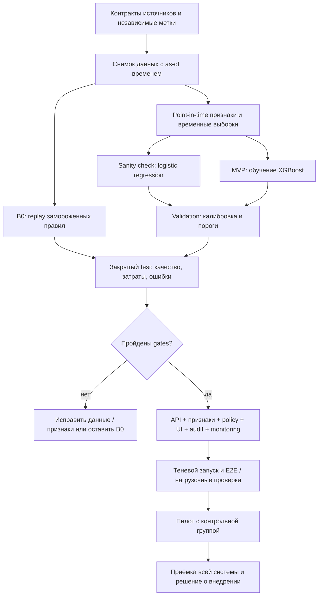
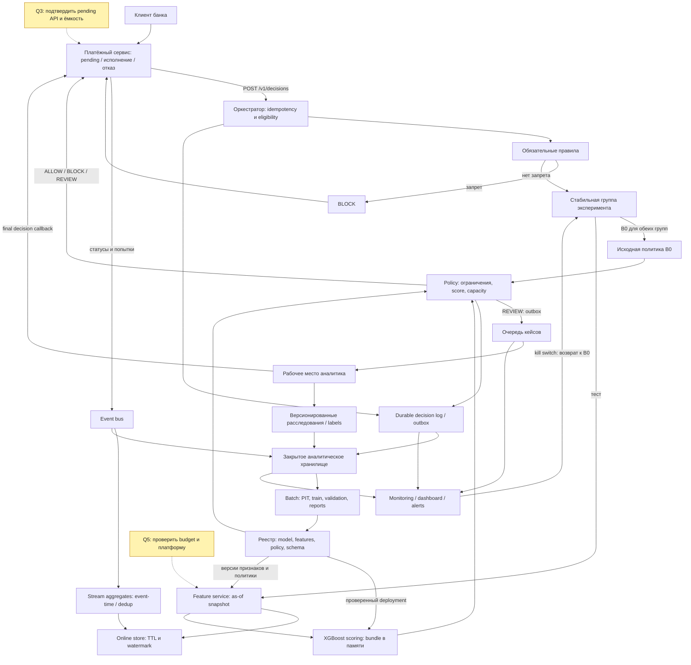

# ML System Design: антифрод банковских переводов

Версия 1.0 · 20 ноября 2026 · статус: учебный проект, проектирование до получения данных.

**Решение:** дополнить действующие правила моделью XGBoost, которая до исполнения перевода оценивает риск фрода. Политика решений возвращает `ALLOW`, `REVIEW` или `BLOCK`; обязательные ограничения имеют приоритет. Эффект оценивается по экономике всей системы, а не только по качеству классификатора.

**Граница достоверности.** Банковские данные, заказчик, замеры и проведённые согласования отсутствуют. Числа с пометкой **УД** — учебные допущения, а не результаты исследования. Требования ниже — предложенный контракт пилота. Все необходимые согласования заведены в [реестре вопросов](OPEN_QUESTIONS.md); без них запуск реальной системы запрещён. Ревью руководителя и результаты эксперимента не заявляются как выполненные.

Исходник: [DDC2023, коммит 59af0db](https://github.com/dmitrii-naumenko/DDC2023/blob/59af0db93f0fd794821d353579cdf250cbc7208a/ML%20System%20Design%20Doc.md). [Неизменённая копия](ORIGINAL.md) и авторство — в [README](README.md). При доработке учтены предоставленные «Критерии оценки ML System Design Doc.pdf» и «антифрод.pdf» — разбор бизнес-процесса, ML-методологии и пилота. Эти материалы служат источниками замечаний, а не доказательствами выполненных работ.

## Навигация

- [1. Цели и предпосылки](#business)
  - [1.1. Контекст и бизнес-метрики](#metrics)
  - [1.2. Требования, AS-IS / TO-BE и пороги](#requirements)
  - [1.3. Скоуп и Definition of Done](#scope)
  - [1.4. Предпосылки](#assumptions)
- [2. Методология](#method)
  - [2.1. Объект, таргет и ML-метрики](#target)
  - [2.2. Baseline, целевая модель и блок-схема](#models)
  - [2.3. Данные и этапы решения](#stages)
- [3. Подготовка пилота](#pilot)
- [4. Внедрение и эксплуатация](#deployment)
- [5. Открытые вопросы и развитие](#questions)
- [6. Источники](#references)

## 1. Цели и предпосылки

### 1.1. Зачем разрабатывать продукт

Банк обрабатывает переводы Card2Card и Account2Account физических лиц. Пропущенное мошенничество создаёт потери и расходы на расследования; необоснованный отказ мешает законным платежам; ручные проверки ограничены числом аналитиков. Заказчик — руководитель антифрода. В решении заинтересованы платёжная команда, поддержка, финансовый контролёр, ИБ и клиенты банка.

Правила полезны для известных сценариев, но требуют ручного сопровождения. ML может учитывать сочетания суммы, частоты операций и новизны устройства. Это проверяемая гипотеза: улучшение на новых схемах и положительный денежный эффект не гарантируются самим выбором ML. Система сохраняет обязательные правила и возможность возврата к исходной политике.

#### Определения и единицы расчёта

- `t` — уникальная попытка перевода; повторы API с тем же `transaction_id` не создают новый объект. Новый перевод клиента имеет отдельный ID.
- `u` — клиент-отправитель, включённый в пилот до показа варианта; его группа неизменна.
- Период наблюдения — фиксированные 28 суток после включения клиента (**УД**). Все его подходящие попытки, включая повторные после отказа, входят в эффект.
- `a_t` — окончательный исход: исполнен, отклонён, истёк срок ожидания или отменён. `REVIEW` — промежуточное решение; его нельзя приравнивать к окончательному отказу.
- `y_t` — подтверждённый фрод / подтверждённая или созревшая нормальная операция; неопределённые метки учитываются отдельно.
- Бизнес-оценка проводится после созревания исходов. Сравниваются случайно назначенные группы на одном календарном отрезке; исторический уровень нужен для планирования, а не заменяет контроль.

| ID | Метрика и алгоритм расчёта | Данные и ответственный |
| --- | --- | --- |
| Q | **Чистый операционный вклад на включённого клиента:** `Q = (Σ commission_t − Σ loss_t − c_review·N_cases − c_support·N_contacts − C_run) / N_users`. Комиссия — фактически полученная за исполнение, loss — подтверждённая невозмещённая потеря банка после возвратов. Все компоненты относятся к операциям фиксированного периода. | Платёжный ledger, реестр убытков и возвратов, кейсы аналитиков, обращения, тариф инфраструктуры. Финконтролёр + аналитик эксперимента. |
| L | **Потери на клиента:** `L = Σ loss_t / N_users`, по всем исходам попыток в группе, с одинаковым сроком дозревания. | Реестр расследований и ledger; руководитель антифрода. |
| F | **Доля ложных окончательных отказов:** `F = N(y=0, final=reject_or_expire_or_review_cancel) / N(y=0)`. Отмена после ML-проверки считается отказом, если разрешённая операция не состоялась в срок. Оценка по независимому стратифицированному аудиту с весами вероятностей отбора. | Исходы платёжного сервиса и независимая разметка; QA антифрода. |
| R | **Доля направлений на проверку:** `R = N_unique_review_cases / N_unique_attempts`. Включает правила и ML; аудит для исследования учитывается отдельно в затратах и ёмкости. | Журнал решений и case management; руководитель смены. |
| C | **Частота обращений по антифроду:** `C = 1000·N_unique_contacts / N_users` за фиксированное окно. Дубликаты в одной цепочке обращения объединяются по case_id. | Поддержка с проверенной категоризацией; руководитель поддержки. |
| A | **Пригодность рабочего места аналитика:** пройдены все обязательные сценарии из §1.3; для каждого есть запись QA о результате и подпись руководителя смены. | Протокол приёмки интерфейса, подписывает руководитель антифрода. |

**Почему нет двойного учёта:** при блокировке комиссия просто не поступает в `Σ commission_t`; её не вычитают второй раз как «упущенную комиссию». Предотвращённая сумма перевода не записывается доходом. Штрафы учитываются только при фактическом начислении и однозначной связи с операцией, без дублирования loss; предполагаемые штрафы и репутационные эффекты исключены из Q. Стоимость разработки оценивается отдельно в окупаемости (§4.7), чтобы не смешивать единовременные и операционные расходы.

### 1.2. Бизнес-требования и ограничения

**AS-IS.** Платёжный сервис перед исполнением вызывает правила. Обязательный запрет блокирует операцию; подозрительная операция создаёт кейс и ожидает решения аналитика; остальные исполняются. Результаты расследований поступают позднее. Конкретный набор правил и фактическая ёмкость команды неизвестны — требуется их версия и подтверждение владельца.

**TO-BE.** После общих обязательных правил клиент получает закреплённую группу. В контроле работает исходная политика. В тесте оркестратор получает признаки и score, применяет версионируемую политику и возвращает предварительное решение. Аналитик завершает `REVIEW` асинхронно. Платёжный сервис исполняет только окончательное разрешение; клиент видит ожидание проверки, причину в разрешённой форме и конечный статус. При недоступности ML используется утверждённая исходная политика, а не безусловное разрешение.

 [Q3: полномочия и политика отказов](OPEN_QUESTIONS.md#q3).

| Ситуация | Действие тестовой системы |
| --- | --- |
| Обязательный запрет, независимо от score | `BLOCK`. ML не отменяет его; такие операции не получают ML-влияния, но остаются в ITT-учёте уже включённых клиентов. |
| Нет обязательного запрета, score ниже `t_review`, исходная политика разрешает | `ALLOW`. |
| score между `t_review` и `t_block` либо исходная политика требует проверки | `REVIEW`, одно дело на transaction_id. |
| score не ниже `t_block` | `BLOCK` только после отдельного допуска на автоматические отказы; до допуска — `REVIEW`. |
| Исходная необязательная политика блокирует, ML разрешает | В MVP блокировка сохраняется. Ослабление действующих запретов — отдельная итерация. |
| ML или признаки недоступны, неверна схема, превышен timeout | Применить исходную политику; записать fallback и поднять алерт. |
| Очередь достигла лимита или невозможно гарантировать срок проверки | Для новых операций отключить ML-влияние, применять исходную политику. Уже открытые кейсы завершает смена; никакого молчаливого исполнения по истечении срока. |

**Предложенный контракт успеха.** Все текущие уровни в таблице — **УД для учебного сценария**, их нельзя выдавать за замеры банка. До реального пилота они заменяются согласованными измерениями Q1. Нельзя выбирать пороги заново после просмотра результатов теста.

| Метрика | Текущий уровень, УД | Требование к пилоту и смысл |
| --- | --- | --- |
| Q | 25 руб./клиент за 28 суток | Эффект тест−контроль не меньше +2,5 руб./клиент (+10% учебной базы); нижняя граница двустороннего 95% ДИ эффекта > 0. Минимальная практическая выгода. |
| L | 10 руб./клиент | Верхняя односторонняя граница эффекта тест−контроль ≤ 0. Потери не должны увеличиться. |
| F | 0,15% | Верхняя односторонняя граница разницы ≤ +0,02 процентного пункта; точечная оценка теста ≤ 0,17%. Допуск — не более двух дополнительных отказов на 10 000 законных попыток. |
| R | 0,50% | Верхняя односторонняя граница разницы ≤ +0,10 п.п.; тест ≤ 0,60%, поток кейсов вместе с аудитом ≤ 720/сутки при 80% загрузки. Ограничение команды. |
| C | 2 обращения / 1000 клиентов | Верхняя односторонняя граница разницы ≤ +0,2 / 1000, тест ≤ 2,2 / 1000. Контроль клиентского опыта. |
| A | Новый интерфейс отсутствует | Все сценарии пройдены, нет открытых критичных дефектов, протокол принят руководителем антифрода. |

Для четырёх защитных метрик L/F/R/C используются односторонние одновременные границы с Bonferroni: α=0,05/4 на каждую; для долей и отношений — интервалы с кластеризацией по отправителю, веса аудита для F. Недостаточная мощность означает «неопределённо», а не доказательство отсутствия вреда. Кроме метрик, обязательны технические ограничения §4.3, безопасность §4.5 и окупаемость §4.7.

 [Q1: бизнес-пороги, фактическая база и экономика](OPEN_QUESTIONS.md#q1). Ограничения и допуски выше пока не согласованы с реальным банком.

### 1.3. Скоуп и Definition of Done

MVP охватывает рублёвые Card2Card и Account2Account переводы физических лиц, для которых нет обязательного запрета. Получатели могут быть внешними; юридические лица, FX, AML/KYC и кредитные решения вне скоупа. Социальная инженерия может дать наблюдаемые признаки, но её полное предотвращение не обещается. Поиск аномалий, графовые модели и автоматическое снятие действующих блокировок отложены.

MVP включает контракт данных, воспроизводимый replay baseline, обучаемую модель, online-признаки, API решения, интерфейс аналитика, сбор исходов, dashboard, мониторинг, эксперименты и откат.

| Сценарий / БТ | Проверка готовности (DoD) | Исполнитель и принимающий |
| --- | --- | --- |
| Обычный перевод | E2E: валидный запрос → решение → исполнение → журнал. Повтор запроса не создаёт второго исполнения или кейса. | Backend + QA; платёжная команда. |
| Подозрительный перевод | Аналитик видит сумму, доступные причины, версии и срок; может разрешить/отклонить; клиент получает итоговый статус. | Backend + QA; руководитель смены. |
| Конфликт правил и ML | Все строки таблицы §1.2 проверены; обязательный запрет нельзя отменить моделью. | QA + руководитель антифрода. |
| Timeout / недоступность / перегрузка | Fault injection подтверждает fallback, сигнал мониторинга и отключение ML-влияния; открытые кейсы не теряются. | SRE + QA; платёжная команда. |
| Модель и данные | Версионированы snapshot, код, cutoff, схема признаков, seed, окружение, параметры, model hash, thresholds и отчёт temporal validation. Нет признаков из будущего. | DS + DE; ML lead / научный руководитель. |
| Проверяемый эффект | Метрики §1.1 воспроизводятся из ledger и назначений групп; опубликован план анализа до теста; приёмка по §3.2. | Аналитик; PO + руководитель антифрода. |
| Эксплуатация | Runbook, on-call, rollback drill и контроль доступа проверены; SLO соблюдены на стенде. | SRE + ИБ; технический владелец. |

Это **план DoD**, не отметка о выполнении. Исходный проект не содержит реализации MVP; поставка этой итерации — доработанный дизайн-документ и план закрытия вопросов. Реализованная система будет отдельным этапом.

Код будущей реализации проходит review и meaningful unit/integration/E2E-проверки контрактов, временных join, маршрутизации, повторов и отказов. Зафиксированы зависимости и команды сборки; персональные данные и модельные артефакты не хранятся в публичном GitHub. Технический долг MVP: ограниченные каналы и признаки, ручной допуск модели, без active learning и графовой антифрод-системы; закрытие обязательной безопасности долгом не считается.

### 1.4. Предпосылки решения

Гранулярность — попытка перевода; прогноз относится к ней самой, вычисляется до авторизации. Горизонт поступления подтверждения — до 60 суток (**УД**, проверить распределение задержек). Доступны блоки: операции, история клиента, устройство, расследования, решения правил, ledger, поддержка. Их фактические источники и права пока не проверены.

Средняя нагрузка 1,5 попытки/с и ориентир Recall=50% при Specificity=99,85% взяты **из исходного документа и независимо не подтверждены**. Ни заявленная трёхлетняя история, ни качество источников не считаются установленными фактами. ML применим при достаточном числе независимых подтверждений фрода; при нехватке разметки первая поставка ограничивается правилами и сбором обратной связи.

Согласования с заказчиком и научным руководителем ещё не проводились. Жёлтые отметки указывают, где они обязательны.

## 2. Методология

### 2.1. Постановка ML-задачи и качество

Это supervised binary classification с редким положительным классом: `p_t = P(y_t=1 | x_t, информация до решения)`. Score не является готовым бизнес-решением; действия определяет политика с учётом стоимости, правил и очереди. Поиск аномалий не заменяет классификацию в MVP.

**Положительная метка:** завершённое расследование с подтверждением мошенничества или подтверждённая претензия, связанная с transaction_id. **Отрицательная:** независимое подтверждение законности либо исполненная операция без открытого спора после окна созревания и при проверенной полноте канала претензий. Отклонённая операция без независимой проверки — `unknown`, а не отрицательная метка. Срабатывание правила, black list и сам факт штрафа не являются достоверной разметкой. Несколько сигналов одного инцидента дедуплицируются; противоречия направляются на арбитраж старшему аналитику и до разрешения исключаются из основной оценки.

Для каждой метки хранятся `event_time`, `label_available_at`, `label_source`, версия и статус расследования. «Нет жалобы за 60 суток» — рабочее допущение, не доказательство отсутствия скрытого фрода. Проверяется остаточный хвост поздних подтверждений, результаты пересчитываются на 90 сутках для чувствительности. Новые данные не изменяют задним числом сохранённую версию итогового отчёта.

 [Q2: разметка, источники и временная доступность](OPEN_QUESTIONS.md#q2).

**Смещение наблюдений.** Аналитики видят преимущественно подозрительные операции; исходные блокировки скрывают исход «что было бы при исполнении». Отдельная независимая проверка отбирает разрешённые, проверяемые и отклонённые попытки с известными ненулевыми вероятностями отбора по каналу, сумме и риску. Метрики аудита рассчитываются с весами `1 / inclusion_probability`; unknown и доля покрытия публикуются. Аудит не означает разрешение заведомо опасных платежей. Если независимая разметка отклонённых недоступна, F и полный recall нельзя достоверно оценить — это блокер, а не повод подставить решение правил как truth. В offline-отчёте тогда допустимы только явно ограниченные оценки по наблюдаемой части и интервалы сценариев.

| Метрика | Расчёт и данные | Связь с бизнесом / критерий |
| --- | --- | --- |
| Recall при FPR≤0,15% | `TP/(TP+FN)` при ограничении `FP/(FP+TN)≤0,0015`; зрелые независимые метки, временной test, веса аудита. ML-положительное решение — `score≥t_review`. | Предварительный gate: Recall≥60% (**УД**) против исходного ориентира 50%; отдельно доверительные интервалы. Это качество направления на проверку, не гарантия предотвращения потерь. |
| Amount-weighted recall | `Σ amount_t·1(y=1, score≥t_review) / Σ amount_t·1(y=1)`; один рублёвый канал, без произвольного удаления крупных операций. | Показывает концентрацию пропущенных сумм; Q/L учитывают именно невозмещённый убыток, который может отличаться от суммы перевода. |
| Precision и PR-AUC | `TP/(TP+FP)` и площадь PR-кривой на естественной распространённости класса; с указанием метода интегрирования и версии библиотеки. | Precision влияет на полезность очереди R; PR-AUC — диагностическая, не самостоятельный критерий запуска. |
| Калибровка | Brier score `mean((p−y)²)` и reliability diagram на отдельном периоде; естественная доля класса. | Нужна для сравнения ожидаемых затрат действий. Веса классов могут нарушить калибровку — это проверяется. |
| Replay политики | На одних попытках воспроизвести правила, пороги, направления и известные окончательные исходы, рассчитать наблюдаемые расходы и чувствительность к неизвестным исходам. | Отдельный отчёт по F/R и прогнозу Q/L; причинный денежный эффект подтверждает только пилот. |

FPR классификатора и доля ложных **окончательных** отказов F — разные показатели. Оба измеряются отдельно. Неопределённый исход проверки нельзя автоматически считать TP или FP окончательной блокировки. ROC-AUC/accuracy не выбирают модель при столь редком классе. Эмпирическая метрика по порогу ступенчатая: подбор делается по уникальным score на validation с учётом ties, а не предположения о гладкости.

### 2.2. Baseline, модель MVP и блок-схема

**Baseline B0 — замороженная исходная политика правил.** Артефакт `rules_v0` содержит точный набор обязательных и необязательных правил, порядок, даты вступления, пороги, признаки и действия. Для replay нужны: сумма, канал, банк отправителя/получателя, доступный на дату платежа статус списка ограничений, результаты проверок клиента/устройства, исходное решение и окончательный исход аналитика. Список ограничений берётся в исторической версии, не в сегодняшнем состоянии. На test применяется тот же протокол зрелости меток, что у ML. Пока исходные правила не получены, реальная воспроизводимость B0 — открытый вопрос Q3, не выполненная работа.

**Прозрачный учебный B0 для прототипа:** обязательный запрет → BLOCK; иначе сумма≥100 000 руб. **или** (новое устройство и ≥3 предшествующих попытки за 10 минут) → REVIEW; иначе ALLOW. `new_device` означает отсутствие устройства в подтверждённой истории до события. Пороги — **УД** для проверки сквозной цепочки. Этот алгоритм не выдаётся за действующие банковские правила или согласованную с заказчиком систему. При появлении реального B0 он заменяется, метрики пересчитываются. Признаки и правила должен подтвердить руководитель антифрода / научный руководитель (Q3).

**Целевая модель MVP — XGBoost (`binary:logistic`) на табличных данных.** Стартовый набор: log(1+сумма), канал, банки, час/день недели, число и сумма предшествующих попыток за 10 минут/час/сутки, время с предыдущей попытки, давность клиента, новый получатель и устройство. ID клиента используется для join, но не как самостоятельный признак. Категории кодируются словарём, обученным только на train, неизвестные значения получают отдельный код; числовые пропуски имеют отдельные индикаторы.

Выбор — инженерная гипотеза: бустинг моделирует нелинейные взаимодействия табличных признаков, допускает CPU-инференс и ограничение сложности. Опора — [Chen & Guestrin, XGBoost](https://arxiv.org/abs/1603.02754); статья обосновывает класс алгоритма и масштабируемость, а не обещает качество на этих банковских данных. Для sanity check обучается logistic regression на тех же доступных признаках. Усложнение оправдано только превосходством B0 и LR при заданных ограничениях. One-Class SVM, autoencoder и GAN исключены из первой итерации: требуют отдельной постановки и не дают автоматической гарантии лучшего обнаружения.

Стартовый ограниченный поиск (**УД**): глубина 3/5/7, learning rate 0,03/0,1, не более 500 деревьев, early stopping на validation, не более 12 конфигураций. Class weights подбираются только внутри train/validation; итоговая калибровка на естественной частоте. Train можно уменьшить по отрицательному классу только с сохранением вероятностей отбора и коррекцией калибровки. Validation/test не балансируются, SMOTE/ADASYN через временные границы запрещены.

**Интерпретация.** Offline считаются importance и SHAP по контрольной выборке, ошибки разбираются по суммам, каналам, новым клиентам и устройствам. Аналитик получает 2–3 устойчивые причины, сформированные из доступных признаков и проверенные экспертом; SHAP не трактуется как причинное объяснение. Тяжёлые объяснения считаются асинхронно и не блокируют авторизацию.

Режим — **синхронное online-решение до исполнения**; накопление истории и обновление коротких агрегатов — потоковые, обучение и дозревшие отчёты — batch. Batch-скоринг раз в сутки не подходит для нового получателя и всплесков попыток между пересчётами.

### 2.3. Данные и этапы решения

#### Этап 1. Контракты источников — без EDA

Точные таблицы, поля, доступы и сроки хранения будут согласованы с владельцами; адреса источников не выдумываются. Флаг «данные есть» из исходника не подтверждает их доступность в этом проекте.

| Смысловой блок | Для чего нужен / где искать | Контрагент и выход этапа |
| --- | --- | --- |
| Попытки и результаты переводов | Сумма, время, канал, участники, статусы; журнал платёжного процессинга и ledger. | Владелец процессинга + DE: схема, уникальность, временные поля, подтверждение полноты. |
| История клиента и получателя | Давность и предшествующее поведение; CRM/KYC-профиль и история платежей. | Владелец клиентских данных: разрешённые атрибуты и исторические версии. |
| Устройство и сессия | Новизна устройства, смена канала; антифрод-телеметрия. | Команда мобильного/веб-банка + ИБ: доступность до решения и доля покрытия. |
| Правила и ручная проверка | Replay B0, назначения и окончательные действия; rules engine и case management. | Руководитель антифрода: rules_v0, история политик, схема кейсов и ёмкость смены. |
| Расследования и претензии | Таргет, время подтверждения, убытки/возвраты; claims/case management. | QA разметки + финконтролёр: регламент арбитража, latency и связи с ledger. |
| Расходы и поддержка | Q, C и стоимость действий; учёт поддержки и бюджет эксплуатации. | Поддержка + финконтролёр: дедупликация обращений и единичные стоимости. |

В MVP не используются свободный текст назначения платежа, сырые геокоординаты и социально-демографические признаки: их дополнительная ценность не доказана, а обработка сложнее. Получение и применение каждого блока требуют Q2/Q6. Результат этапа — подписанный контракт, пробная обезличенная выборка и список недоступного; без независимых меток этап обучения не стартует.

#### Этап 2. Проверка и подготовка

Вход — контракты этапа 1. DE/DS проверяют дубликаты попыток и событий, переходы статусов, единицы сумм, UTC/event/processing time, пропуски по дням и каналам, задержки источников, полноту претензий и долю unknown. Исследуются естественная доля фрода, хвосты сумм, сезонность и покрытие признаков; никаких результатов EDA до её выполнения здесь не заявлено.

Для baseline воспроизводятся исторические правила и доступные в тот момент списки. Для MVP строятся as-of join: историческое событие предшествует решению, а `available_at` не позже времени решения. В агрегаты текущая попытка не входит; запоздалые события нельзя задним числом добавить в обучающий online-snapshot. Результат — отчёт качества, каталог признаков с версией и согласованный период. Gate: воспроизводимые joins, понятные пропуски, независимая проверка разметки; иначе возврат к владельцам данных.

#### Этап 3. Временная валидация без утечки

План обучения — rolling window 6 месяцев (**УД**, уточнить после EDA). Для каждого исторического cutoff `c` train содержит только операции с `event_time<c` и **метками, уже доступными в c**. Нормальные примеры, требующие 60 суток созревания, также должны быть зрелыми к c. Модель и трансформации замораживаются в c; validation — следующие 28 суток, её labels читаются позднее, после дозревания, только для оценки.

Три rolling-origin фолда оценивают устойчивость по времени. Устаревшие или незрелые данные не «чинятся» случайным стратифицированным split. Если несколько операций одного инцидента пересекают границу и независимость нарушена, применяется группировка инцидентов / embargo, длина обосновывается фактическим процессом. Нужен также срез cold-start клиентов. Случайное пересечение клиентов train/test допустимо для работающей системы с возвращающимися клиентами, но не даёт права использовать их будущую историю.

**Календарь финальной проверки:** период V (28 суток) используется для выбора модели, калибратора и порогов; затем ждём 60 суток до зрелости V. В дату `c_final` фиксируем окончательный bundle; закрытый test — последующие 28 суток. Отчёт test создаётся не ранее `c_final+28+60` суток. Если принято переобучить модель в `c_final`, train использует только доступные в эту дату метки, а отдельный зрелый calibration-период не пересекается с train; весь bundle фиксируется до test. Перевыбор по test запрещён. Неудача на test означает новую версию и новый будущий holdout.

Таким образом, validation не «подглядывает» в метки, недоступные до начала test. Условный gap в 1–2 недели сам по себе эту проблему не решает. Принцип задержанной обратной связи опирается на [Dal Pozzolo et al.](https://dalpozz.github.io/static/pdf/TNNLS_2017.pdf); перенос на банковские переводы — проектное решение, а не доказанный результат.

#### Этап 4. Отдельно baseline и MVP

| Ветка | Вход и техника | Выход / переход |
| --- | --- | --- |
| B0 | Версия правил, исторические признаки и статусы; replay без обучения, контроль совпадения с логом. Для учебного алгоритма — явный конфиг порогов. | Отчёт решений, покрытия, F/R, наблюдаемых затрат и unknown; реальный baseline подтверждён владельцем. |
| ML | Те же доступные операции + PIT-признаки; LR, XGBoost, ограниченный поиск, отдельная калибровка. | Версионированный bundle, метрики по времени/сегментам, сравнение с B0 на одинаковой оценочной совокупности. |
| Политика MVP | Перебор `t_review≤t_block` на validation; минимизация оценочных затрат при ограничениях FPR, ёмкости и потерь. Сценарии неизвестных исходов представлены диапазоном. | Замороженные пороги и политика; без допуска automatic BLOCK работает как REVIEW. Не хватает ёмкости — оставить B0. |

`t_block` нельзя численно назначить без шкалы обученной и калиброванной модели. Это конкретный результат этапа, подлежащий фиксации в model manifest до test; отсутствие выдуманного score не заменяет план его получения. Изменение порогов во время A/B — новая политика и отдельный эксперимент, кроме аварийного отключения.

#### Этапы 5–7. Сервис, пилот и передача

1. Backend/DE интегрируют API, агрегаты, журнал, UI и метки; QA прогоняет §1.3. Выход — E2E-протокол и проверка online/offline parity.
2. SRE выполняет load/fault tests, DS — теневой отчёт, аналитик — проверку рандомизации. Выход — готовность к пилоту §3.1; незакрытые Q1–Q6 блокируют влияние на платежи.
3. Аналитик оценивает дозревшие исходы, PO принимает решение §3.2; SRE передаёт runbook и on-call. Выход — протокол go/no-go, дальнейший план. Неудача и неопределённость также документируются.

## 3. Подготовка пилота

### 3.1. Дизайн и способ оценки

**Роли.** QA тестирует сценарии и интеграции; DS отвечает за offline-отчёт и bundle; DE — за данные; SRE — за нагрузку и восстановление; старший аналитик антифрода — за аудит меток; аналитик эксперимента — за разбиение, размер выборки и итоговый отчёт. Руководитель поддержки проверяет C, финконтролёр — Q и окупаемость. Решение go/no-go принимает **руководитель антифрода как Product Owner** после заключений платёжной команды и ИБ. ФИО в учебном кейсе неизвестны, должности определены; назначение конкретных людей и встреча с научным руководителем — Q7.

**Контуры и последовательность:**

1. Тестовый контур платёжного сервиса: синтетические/обезличенные переводы, контракт API, все DoD, отказы зависимостей и нагрузка. Денежного исполнения нет.
2. Теневой запуск в production на 14 суток (**УД**): ML читает копию запроса, не меняет ответ правил, пишет score и гипотетическое действие. Сверяются признаки, latency, полнота логов и предварительная очередь. Денежный причинный эффект в shadow не измеряется; сравнение score не доказывает предотвращение потерь.
3. A/A маршрутизации на 7 суток: одинаковая исходная политика, проверка долей групп, стабильности назначения, полноты исходов и расчёта метрик. Дозревшие метрики дополнительно проверяются по историческому replay; неделя A/A не доказывает качество поздней разметки.
4. Ограниченный canary: 1% подходящих клиентов на 2 суток, затем 5% на 5 суток; исходные запреты одинаковы. Это техническая проверка; её клиенты не включаются в подтверждающий тест. До старта основной выборки отсутствует повторное включение canary-клиентов.
5. Подтверждающий A/B: среди новых подходящих клиентов 50/50, контроль B0 и тест B0+ML. Набор 28 календарных суток, каждый участник наблюдается 28 суток после включения. Предельная продолжительность набора — 56 суток, но выбор между 28 и 56 делается **до старта** по мощности. Если нужного объёма нет, подтверждающий эксперимент не запускается, а план пересматривается.

Рандомизация — стабильный hash sender_id + experiment_id, стратификация по каналу и предпилотному риску; eligibility фиксируется до решения системы. Клиенты с обязательным запретом на дату включения не набираются в эксперимент. После включения eligibility клиента не пересматривается: последующие обязательные запреты применяются в обеих группах, а все попытки и потери остаются в ITT-учёте с отдельным флагом. Это предотвращает исключение исходов, возникших уже после воздействия. Основной анализ — intention-to-treat: fallback-клиенты остаются в назначенной группе. Отдельно показываются доля фактического ML-влияния, ошибки и обходы маршрутизации.

Клиент может встречаться как получатель и влиять на поведение связанных аккаунтов. Фродовые сети и общие аналитики создают интерференцию. Команды контролируют пересечения графовых кластеров и загрузку очередей; для анализа сохраняется кластер инцидента. При значимом взаимовлиянии sender-randomization непригодна: до теста выбирается кластерная рандомизация и заново рассчитывается мощность. Эксперимент не «чинят» постфактум удалением неудобных клиентов. Для контроля/теста выделяется учёт очереди и мощности, чтобы нагрузка теста не ухудшала контроль скрыто.

#### Объём и календарь

Основная гипотеза: положительное изменение Q, минимально полезный эффект δ=2,5 руб./клиент. Для планирования α=0,05, power=0,8; при **УД** σ=50 руб. за полный период на клиента оценка размера на группу:

`n ≈ 2·(1,96+0,84)²·σ²/δ² = 6272 клиента`.

Это иллюстрация для **готовой клиентской агрегированной метрики**, не расчёт по транзакциям и не достаточный размер всего эксперимента. Для редких отказов F нужно существенно больше. Например, при F=0,0015, допуске 0,0002 и Bonferroni для четырёх защитных метрик, грубая независимая оценка составляет порядка **710 тыс. размеченных законных попыток на группу** до поправок на повторные операции, дизайн аудита и пропуски. Фактический объём определяется симуляцией всего протокола на исторических данных с повторной выборкой отправителей и инцидентов, включая latency, тяжёлые хвосты и веса аудита. Дизайн принимается по максимуму требований Q/L/F/R/C.

При 1,5 попытки/с за 28 суток приходит около 3,63 млн попыток всего; после eligibility, отсутствия обязательных запретов, staffed hours, дедупликации, разбиения и аудита доступных наблюдений будет меньше. Следовательно, 28 суток не объявляются достаточными заранее. В пилотном плане фиксируются финальные n, вероятность отбора аудита, минимальное число подтверждённых fraud и зрелых normal по каналам. Нет ресурса на аудит и требуемой мощности — нет go.

 [Q4: мощность, аудит и календарь](OPEN_QUESTIONS.md#q4).

Для набора длительностью D дней финальный отчёт возможен не раньше **D + 28 + 60 суток от начала набора**: последний включённый клиент завершает наблюдение, затем дозревает последняя операция. При D=28 это 116 суток. Ежедневные жалобы и технические показатели — ранний контроль, а не замена зрелой Q/L/F. На 90 сутках после последнего события проводится заранее запланированный анализ чувствительности к поздним меткам.

Q/L и отношения по событиям оцениваются с кластеризацией по отправителю; независимый аудит F дополнительно учитывает вероятности отбора. Планируются доверительные интервалы через bootstrap целых клиентов с сохранением всех их операций, а чувствительность — через блоки календарных дней/инцидентов. Инциденты с большими потерями не удаляются ради значимости. Метод и правила очистки фиксируются в плане до теста; показатели по дням служат диагностике. Сегменты анализируются как вторичные, без выбора победителя по удачному срезу.

SRM проверяется на назначенных клиентах, не на числе транзакций. Аварийные триггеры: рост технических ошибок, нарушение SLO, превышение лимита очереди, подтверждённый критичный инцидент фрода. Они могут остановить тест по безопасности, но не объявить победу. Ежедневные проверки p-value Q для раннего успеха не проводятся.

### 3.2. Правило приёмки

**Go** только если одновременно выполнены требования всех Q/L/F/R/C/A из §1.2, пройдены gates качества §2.1 и техническая/безопасностная приёмка, подтверждена положительная экономика §4.7, а Q1–Q7 закрыты необходимыми решениями. Формулы и уровни здесь не дублируются.

**No-go** при нарушении ограничений: возврат к B0, разбор причин и новая версия. **Неопределённо** при незрелых исходах, слабой мощности, неполноте аудита или нарушении рандомизации: production-расширение запрещено; проводится дополнительный заранее спроектированный эксперимент. Итог оформляется протоколом с датой, bundle, policy, отчётом, исключениями и решением PO. В учебном проекте такого протокола пока нет.

### 3.3. Подготовка ресурсов

Для прототипа — CPU, без GPU: до 8 vCPU/32 GB RAM на обучающий запуск, до 12 конфигураций, лимит 24 CPU-часа на цикл поиска (**УД**). Превышение останавливает исследовательскую задачу и требует пересмотра объёма/поиска. Профилируются загрузка данных, fit и inference; ограничение проверяется экспериментально с B0 и LR, затем с XGBoost. Для pilot обязательны стенд, обезличенный replay, нагрузочный генератор, аудит и дежурная смена; расходы на них включены в бюджет.

## 4. Внедрение и эксплуатация

### 4.1. Архитектура

В тестовой группе вычисляются и B0, и ML-score; policy ожидает оба результата в пределах общего deadline и сохраняет исходные запреты. В контроле score не влияет на решение.

Конечные пользователи — платёжный сервис, клиент банка, аналитик антифрода и владельцы dashboard. Online-решение возвращается синхронно; аналитик не должен уложиться в timeout API. Платёжный сервис поддерживает отдельный pending-state, уведомление клиента и идемпотентное завершение. Если такого контракта нет, REVIEW-сценарий MVP нельзя включать до доработки интеграции (Q3).

Короткие агрегаты используют события попыток, принятых **до** текущего решения. Задержка и watermark сохраняются вместе со snapshot; текущая попытка не добавляется повторно при retry. Неизвестная/слишком старая история означает индикатор missing либо fallback по контракту, а не чтение будущего. Состояние признаков восстанавливается из event log.

### 4.2. Инфраструктура и масштабирование

**УД:** внутренний сетевой контур, контейнеры, две scoring-реплики по 2 vCPU/4 GB на разных узлах, Redis-compatible online store, PostgreSQL-compatible case/decision store, существующий брокер событий и закрытое object storage для моделей. Kubernetes — вариант развёртывания при наличии общей платформы, отдельный кластер ради нагрузки 1,5/s не требуется. Реальные продукты, HA-топология и стоимость выбираются после Q5.

Scoring масштабируется горизонтально по p95 latency и CPU; модель загружается в память при старте, readiness только после проверки hash и схемы. Feature store и запись журналов профилируются отдельно: дополнительные scoring-поды не устранят их перегрузку. Для низкой нагрузки один partition consumer достаточен, затем шардинг по отправителю с сохранением порядка и контролем горячих ключей. Failover хранилища и восстановление состояния проверяются на стенде.

### 4.3. Производительность и надёжность

Все числа — **проектные УД**, а не результаты нагрузочного теста.

| Компонент | Бюджет / нагрузка |
| --- | --- |
| Decision API | Среднее 1,5 req/s, проектный пик 100 req/s на 10 минут. p95≤300 ms, p99≤700 ms; общий timeout 1 s от получения запроса до ответа, включая правила и fallback. |
| Бюджет latency | Правила/маршрутизация 40 ms, признаки 100 ms, scoring 40 ms, policy и durable log 60 ms, сеть/резерв 60 ms = 300 ms. Это сумма бюджетов этапов, не математическое сложение их измеренных p95. |
| Поток событий | При 3 событиях на попытку: 4,5/s в среднем, 300/s в пике. Size≤2 KB/event — около 0,78 GB/сутки без реплик. |
| Decision/features log | При 5 KB/попытку: 129 600 попыток/сутки → 0,65 GB/сутки. За 90 суток около 58 GB raw; ×3 реплики ×2 запас = 350 GB. Event log и backups учитываются дополнительно. |
| Очередь аналитиков | **УД:** 3 аналитика ×8 часов /1,6 минуты =900 кейсов/сутки, безопасный предел 80%=720, включая аудит. ML-REVIEW доступен только в часы подтверждённого покрытия сменой; иначе B0. |
| Online-признаки | Обновление коротких окон p95≤5 s, p99≤15 s; при watermark lag>30 s — fallback. Допуск задержки подтверждает Q5 и проверяет attack replay. |
| Доступность | ≥99,9% за 30 суток для валидного policy-ответа в timeout, включая корректный B0-fallback. Это ≤43,2 минуты недоступности за 30 суток. Доля fallback измеряется отдельно, цель <1%. |
| Восстановление | Вернуть B0≤1 минуты, восстановить scoring≤30 минут. Для принятых платёжных решений RPO=0 за счёт ledger и durable outbox; для feature state допускается пересборка из журнала, ML до неё отключён. |

100 req/s ×0,7 s ≈70 одновременно исполняемых запросов — ориентир по concurrency, не доказательство достаточности двух реплик. Размер serving определяется измерениями. Средняя оценка 0,6% от 129 600 =778 кейсов/сутки уже превышает 720 без аудита: поэтому действует **более строгое** ограничение по абсолютной ёмкости, активным часам и текущему backlog. Нельзя считать процент R единственным ограничением.

До пилота Q3 фиксирует время pending (предложение: до 15 минут), доступную ёмкость и предельный backlog в минутах работы смены. При достижении 80% прогнозного лимита — alert, при 100% — отключение новых ML-эскалаций; обязательные проверки сохраняются. Автоотказ/разрешение ранее открытых кейсов без утверждённого правила запрещён.

**Нагрузочные сценарии:** steady 1,5/s на час, spike 100/s на 10 минут, retry storm с повторами ID, горячий отправитель, delayed/out-of-order events, падение scoring-реплики, отказ store/broker, переполнение очереди и rolling deployment. QA/SRE проверяют p95/p99, error/fallback rate, отсутствие двойного исполнения/дела, полноту outbox, watermark и корректный откат. После восстановления события доставляются без потерь и с дедупликацией. Результаты ещё не получены; протокол и подбор ресурсов — Q5.

### 4.4. Мониторинг и замена модели

- **Техника:** latency, timeout, errors, traffic, saturation, feature lag, очередь, запись outbox, fallback и версии bundle. SRE получает page при p99>700 ms или errors>1% 5 минут; нарушения целостности решения вызывают немедленное отключение ML. Малый трафик требует проверки минимального числа событий, аварии не ждут статистики.
- **Данные:** missing, неизвестные категории, watermark, расхождение offline/online. Критичная несовместимость схемы — fallback; drift score/признаков — расследование DS, не автоматическое production-переобучение.
- **Бизнес и ML:** ежедневные R/C и доля unknown; зрелые Q/L/F/Recall по когортам, каналам и суммам. Нельзя сравнивать незрелый последний день с завершённым месяцем. Dashboard показывает знаменатели, покрытие и дату as-of.

Раз в месяц предлагается обучать новую модель на rolling 6 месяцах с доступными зрелыми labels; частота пересматривается по drift/latency. Train и evaluate — отдельный pipeline; bundle включает модель, калибратор, фичи и policy. Новая версия проходит temporal gates, аудит ошибок, shadow и ограниченный canary. Допуск подписывают DS lead и руководитель антифрода. При провале остаётся предыдущий совместимый bundle или B0. Сам дрейф не даёт права автоматически переключить финансовые решения.

### 4.5. Безопасность системы и данных

Внутреннее хранение само по себе не обеспечивает безопасность. Разделены сервисные роли: scoring читает только нужные признаки; разметчик видит кейсы своей роли; обучение использует обезличенные snapshots; production-deploy доступен ограниченной роли. Сетевые allowlist, service authentication/mTLS, шифрование транспорта и хранилищ, централизованное управление секретами, audit доступа и изменения политик, проверка образов и подписанных bundle обязательны.

Публичный GitHub содержит только дизайн и искусственные примеры — без клиентов, платёжных реквизитов, доступов и обученных на закрытых данных артефактов. Токенизированные ID всё ещё требуют защиты в закрытом контуре. Сырые тексты/геоданные не собираются для MVP; сроки хранения и удаления по каждому классу данных, цели обработки, права и юридические основания подтверждают владельцы банка/ИБ. Предложение 90 суток hot logs — техническое допущение, не юридическое требование. После согласованного удаления очищаются и производные datasets/backups по регламенту.

Защита от атак: ограничение частоты запросов, проверка входной схемы/размеров, replay/idempotency protection, контроль poisoning и доступов к разметке, запрет загрузки непроверенных моделей. Клиенту не раскрываются точные пороги и внутренние списки. Доступ к причинам отказов и режим расследования подтверждает ИБ. Рассмотрения нормативных требований и утверждения соответствия законодательству в этом учебном проекте не проводилось.

 [Q6: ИБ, данные и доступы](OPEN_QUESTIONS.md#q6).

### 4.6. Контракты интеграции

| Связь на схеме | Контракт / поведение |
| --- | --- |
| Payment → Orchestrator | `POST /v1/decisions`: transaction_id, request_id, event_time, amount_minor, currency, channel, токенизированные sender/recipient/device IDs. Время receipt и available_at ставят доверенные сервисы. ID обязателен, сумма целочисленная. |
| Orchestrator → Payment | decision=`ALLOW/BLOCK/REVIEW`, decision_id, score (может отсутствовать при B0), reason_codes, bundle_version, rules_version, policy_version, experiment/group, fallback_flag, expires_at. REVIEW означает pending. Невалидный запрос → 4xx, зависимость/timeout → утверждённый fallback; исключение не превращается в ALLOW. |
| Orchestrator → Features → Model | Одна согласованная feature-schema, cutoff и watermark, missing indicators. Score отвечает с model hash и latency. Несовместимость — исключение bundle из готовых и B0. |
| Policy → Queue | Durable outbox `review.created.v1`, case_id и transaction_id; at-least-once доставка, consumer дедуплицирует. Пока кейс надёжно не записан, REVIEW не считается успешным ответом. |
| Analyst → Payment | Авторизованный callback `POST /v1/review-decisions`, case_id, transaction_id, final_decision, version, analyst_role, decided_at. Idempotency, допустимые переходы состояния и защита от запоздалого callback обязательны. |
| Payment → Bus → Data | `transaction.status.v1`, event_id, transaction_id, status, event_time, available_at, seq/version. Outbox и replay, late events и схемы версионированы. |
| Labels → Data | `fraud.label.v1`: transaction_id, label/status/source, label_available_at, version. Решение кейса и подтверждение фрода — отдельные сущности. |
| Registry → Deployment | Immutable manifest и hash модели, версии признаков/политики; readiness при полной совместимости, возможность атомарного rollback. |

Один transaction_id с тем же телом возвращает сохранённое решение, изменённое тело — conflict 409. Окончательное исполнение дедуплицирует сам платёжный ledger. После перевода в terminal state callback не исполняет платёж повторно; конфликт передаётся в операционный разбор. Timeout, retry/backoff, срок idempotency и точный pending-contract завершаются вместе с платёжной командой в Q3/Q5 до реализации.

### 4.7. Издержки и окупаемость

Учебная смета: DS 2 FTE×2 мес×300 тыс.=1,2 млн руб.; DE/Backend 2×2×250 тыс.=1,0 млн; QA/SRE/PM вместе 2 чел.-мес×250 тыс.=0,5 млн; резерв 20%=0,54 млн. **C_build=3,24 млн руб.** Это сценарные внутренние стоимости, не рыночная оценка и не согласованный бюджет. Операционные расходы инфраструктуры **УД** 150 тыс./мес, аудит/сопровождение сверх исходного процесса 100 тыс./мес; затраты исходной смены учитываются по фактическим кейсам в Q. Стоимость кластера, хранилища, HA, backups и лицензий требует Q5.

Пример: валовая дополнительная выгода от комиссий и меньших потерь/операционных действий 800 тыс./мес, новая инфраструктура и сопровождение 250 тыс./мес → `ΔV_month=550 тыс.`, окупаемость `3,24 млн / 550 тыс.≈5,9 мес.`. Все суммы примерные; это не результат пилота. Длительность 28 суток нормализуется на календарный месяц при прогнозе, масштаб клиентов и пропускная способность должны совпадать с пилотной оценкой Q.

Gate: нижняя консервативная оценка месячного дополнительного вклада после C_run положительна и `C_build / ΔV_month ≤12 месяцев` (**УД**, Q1). Расходы не вычитаются повторно, если уже вошли в Q. Чувствительность: при половине валовой выгоды (400 тыс.) и прежних 250 тыс. затрат окупаемость 21,6 месяца — no-go; при 800 тыс. выгоды и 300 тыс. затрат — 6,48 месяца. В бюджет принятия решения входят также расходы длинного пилота и независимого аудита; без их оценки реальной окупаемости не заявляем.

### 4.8. Риски и plan B

| Риск / сигнал | Действие и ответственный |
| --- | --- |
| Нет независимой разметки блокировок / F неидентифицируема | QA разметки организует независимый аудит; до него только shadow, без заявления полного recall/F. |
| Метки опаздывают, неверные доступности | DE восстанавливает as-of наборы, DS пересчитывает модель и метрики; rollout остановлен. |
| Новый фрод, крупные убытки | Руководитель антифрода вводит проверенные emergency rules, отключает ML-влияние при критичном риске; расследование и новая версия. Нельзя скрыть крупные убытки winsorization. |
| Переполнение review / общий ресурс искажает A/B | Отсечь новые ML-эскалации по capacity gate, оставить B0, разделить учёт; Q3/Q4 пересматривают мощность/штат до повторного теста. |
| Недоступны модель, online store или journal | Оркестратор возвращается к B0; при невозможности durable решения применяется аварийный контракт платёжной команды, не безусловный ALLOW. SRE восстанавливает outbox/state. |
| Статистики недостаточно / межгрупповое влияние | Аналитик ставит «неопределённо», проектирует достаточный или кластерный тест; никаких побед по прокси-жалобам. |
| Смещение между каналами/новыми клиентами | DS публикует сегментные метрики и coverage; проблемный сегмент исключается из нового скоупа только до следующего эксперимента, не из текущего анализа. |
| Утечка данных / poisoning меток | ИБ ограничивает доступ, сохраняет audit и запускает incident response; модель и входные snapshots изолируются до проверки. |
| Экономика не сходится | PO оставляет правила, ограничивает стоимость проекта; ML не внедряется ради самого ML. |

## 5. Открытые вопросы и развитие

Жёлтые обозначения Q1–Q7 и жёлтые блоки архитектуры — непроработанные вопросы. Для каждого есть [GitHub Issue с планом, сроком и контрагентами](OPEN_QUESTIONS.md). Сроки плановые для учебного проекта, не договорённости реальных сотрудников.

 [Q7: назначение ролей и независимое ревью](OPEN_QUESTIONS.md#q7).

Дальнейшие итерации после приёмки: новые каналы, улучшение аудита/обратной связи, графовые признаки связей и поиск аномалий для расследований, оценка drift-aware обучения. Каждое расширение требует нового контракта данных, оценки экономики и эксперимента; «нейросеть» не является обязательным следующим шагом.

## 6. Источники и основания решений

1. [Исходный дизайн DDC2023](https://github.com/dmitrii-naumenko/DDC2023/blob/59af0db93f0fd794821d353579cdf250cbc7208a/ML%20System%20Design%20Doc.md) — предметный кейс банковского антифрода. Авторство сохранено в README и неизменённой копии.
2. «Критерии оценки ML System Design Doc.pdf», предоставлены пользователем — структура, бизнес/ML/пилот, открытые вопросы, история коммитов. PDF не публикуется в репозитории.
3. «антифрод.pdf», предоставлен пользователем — дополнительное ревью: конфликт правил и модели, MVP, baseline, разметка, временная доступность, деньги и пилот. PDF не публикуется; учтённые предложения перечислены в [матрице критериев](CRITERIA_CHECKLIST.md).
4. [Chen, Guestrin. XGBoost: A Scalable Tree Boosting System (2016)](https://arxiv.org/abs/1603.02754) — выбор табличного бустинга и ограничения сложности; качество на этом кейсе не установлено.
5. [Dal Pozzolo et al. Credit Card Fraud Detection: a Realistic Modeling and a Novel Learning Strategy](https://dalpozz.github.io/static/pdf/TNNLS_2017.pdf) — verification latency, class imbalance и смещение investigator feedback. Работа о карточных платежах, поэтому перенос на переводы требует валидации.

**Что проверено при подготовке:** прочитаны исходник и оба PDF; выполнена структурная и арифметическая проверка документа. **Что не проводилось:** EDA, обучение, нагрузочные тесты, согласования банка, юридическая экспертиза и A/B. Их отсутствие не маскируется учебными численными примерами.
