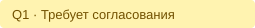
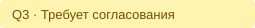

# Открытые вопросы

Все задачи относятся к учебному кейсу. Плановые сроки отсчитываются от 20 ноября 2026, реальные встречи и согласования не проводились. Владелец подготовки материалов — balamozhnovma; перечисленные роли — необходимые контрагенты, а не назначенные сотрудники банка. Реальный pilot требует закрытия соответствующих блокеров.

## Q1. Бизнес-метрики и экономика

[GitHub Issue #1](https://github.com/balamozhnovma/antifraud-ml-system-design/issues/1)

Срок: **23.11.2026**. Контрагенты: руководитель антифрода / PO, финансовый контролёр, поддержка, научный руководитель.

План: проверить текущие Q/L/F/R/C, definitions ledger и потерь; согласовать минимально полезный эффект, ограничения и сроки окупаемости; оценить стоимость разработки, длинного пилота, независимого аудита и эксплуатации. Результат: протокол метрик с формулами, измеренной базой, порогами и бюджетом. Пока все значения учебные. Блокирует реальный A/B.

## Q2. Источники, признаки и разметка

[GitHub Issue #2](https://github.com/balamozhnovma/antifraud-ml-system-design/issues/2)

Срок: **24.11.2026**. Контрагенты: DE, владельцы процессинга/CRM/телеметрии, старший аналитик расследований, DS lead.

План: установить точные источники, схему, покрытие и права; определить независимые fraud/normal/unknown, приоритет и арбитраж противоречий; измерить label_available_at и задержку претензий; подтвердить PIT-доступность каждого признака и регламент независимого аудита. Результат: контракты данных, разрешённый список признаков, регламент меток и дизайн аудита. Правила не используются как ground truth. Блокирует обучение и достоверную оценку.

## Q3. Правила, полномочия решений и ёмкость

[GitHub Issue #3](https://github.com/balamozhnovma/antifraud-ml-system-design/issues/3)

Срок: **25.11.2026**. Контрагенты: руководитель антифрода, платёжная команда, руководитель смены, QA, научный руководитель.

План: получить rules_v0 с историческими списками и порогами; согласовать признаки baseline и ML, таблицу конфликтов, условия automatic BLOCK, pending/callback API, время ожидания, штат/часы/стоимость проверки и backlog. Результат: подписанная политика, сценарии E2E и подтверждённый B0 replay. До этого допустим только учебный baseline и shadow без влияния на деньги.

## Q4. Пилот, мощность и календарь

[GitHub Issue #4](https://github.com/balamozhnovma/antifraud-ml-system-design/issues/4)

Срок: **26.11.2026**, после Q1–Q3. Контрагенты: аналитик экспериментов, DS, QA разметки, PO, руководитель смены.

План: симулировать протокол на исторических клиентах/инцидентах; оценить n для Q и всех защитных метрик, объём независимого аудита и unknown; проверить интерференцию и необходимость кластерной рандомизации; зафиксировать набор 28 либо 56 суток до старта и дату итоговой зрелой оценки. Результат: замороженный experiment/analysis plan. Иллюстрация 6272 клиента не заменяет расчёт мощности всего эксперимента. Блокирует подтверждающий A/B.

## Q5. Инфраструктура, нагрузка и восстановление

[GitHub Issue #5](https://github.com/balamozhnovma/antifraud-ml-system-design/issues/5)

Срок: **27.11.2026**. Контрагенты: SRE, Backend, DE, платёжная команда.

План: выбрать существующую платформу, проверить размеры событий и фактические пики; измерить CPU/memory/latency и feature lag; подтвердить durable outbox, idempotency, fallback/RPO; провести load/fault/rollback tests. Результат: протокол нагрузочного теста, ресурсы, смета, SLO, runbook и дежурство. Все цифры производительности пока проектные. Блокирует production-пилот.

## Q6. Безопасность и данные

[GitHub Issue #6](https://github.com/balamozhnovma/antifraud-ml-system-design/issues/6)

Срок: **27.11.2026**. Контрагенты: ИБ, владелец персональных данных/правовая функция банка, DE, SRE.

План: подтвердить цели и основания обработки, minimization, роли, шифрование, service auth, audit, retention/deletion включая производные snapshots/backups; проверить безопасность моделей и разметки, сценарий инцидента. Результат: утверждённый data/security contract, роли и протокол проверки. В публичном GitHub только проектный текст и искусственные примеры. Блокирует использование реальных данных.

## Q7. Ответственные и независимое ревью

[GitHub Issue #7](https://github.com/balamozhnovma/antifraud-ml-system-design/issues/7)

Срок: **30.11.2026**, после решений Q1–Q6. Контрагенты: PO, ML lead / научный руководитель, QA, платёжная команда, ИБ.

План: назначить конкретных участников тестирования и лицо go/no-go; пройти матрицу критериев и противоречия; утвердить DoD и календарь, зафиксировать решения и оставшийся долг. Результат: протокол независимого ревью с замечаниями и решением. Наличие этого документа не означает, что команда его одобрила. Блокирует финальную приёмку.
